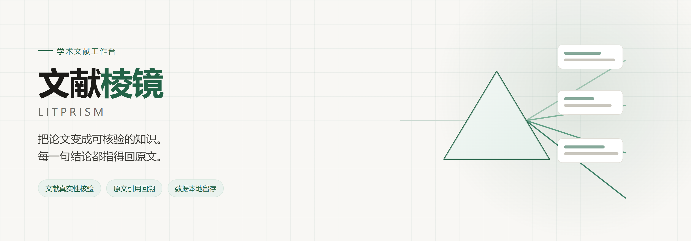
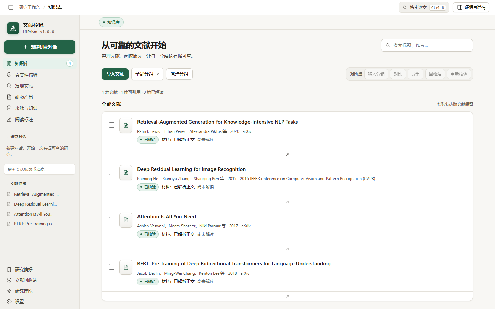
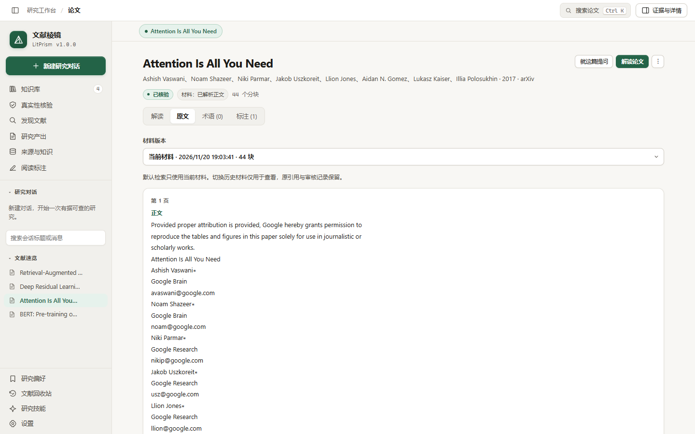
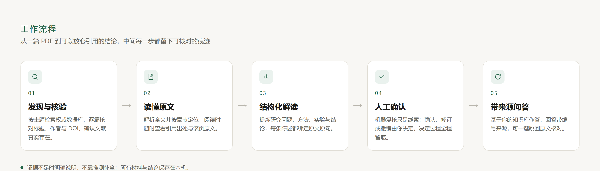

<div align="center">
  
</div>

<div align="center">

[](https://github.com/kingjone0/litprism/releases)


</div>

**文献棱镜**是一个桌面端的文献研究与阅读工具。它把 PDF 论文整理成结构化知识，
回答问题时带上可点击的原文出处——**让你能核对，而不是只能相信**。

---

## 为什么需要它

用通用 AI 读论文，常遇到三个问题。这个项目针对每一件都做了具体处理：

| 你会遇到 | 它是怎么处理的 |
|---|---|
| **凭空出现一篇不存在的论文** | 入库前先在 Crossref / OpenAlex / arXiv 核对题录；核验不通过的文献无法进入知识库 |
| **答案说得头头是道，却找不到出处** | 每条结论都绑定原文片段与页码，点击即可跳回原文；证据不足时直接说明，不靠推测补全 |
| **读完了，知识还是散落在各个 PDF 里** | 解读、术语、笔记、问答沉淀在同一个本地库，带版本与审核状态 |

---

## 核心功能

| 功能 | 说明 |
|---|---|
| **文献发现与核验** | 按主题检索权威数据库，逐篇核对标题、作者、DOI；也可以直接导入本地 PDF |
| **全文阅读** | 解析后按章节导航，正文与引用片段在同一屏对照，随时跳页 |
| **开放全文获取** | arXiv 直连；其他论文按 DOI 查开放副本；订阅文献可打开原文后自行下载导入 |
| **阅读标注** | 选中原文写批注，跨论文汇总，点击回跳原句，导出 Markdown / CSV |
| **结构化解读** | 自动提炼研究问题、方法、实验、结论等要点，每条陈述都能定位到原句 |
| **带来源问答** | 基于你的知识库和已确认材料作答，回答带编号来源，可逐条回溯 |
| **多篇对比** | 选中若干论文，就方法、数据、结论做横向对照，差异处标注各自出处 |
| **人工审核** | 机器复核只作为线索；确认、修订、撤销都由你决定，过程留痕可查 |
| **数据管理** | 一键备份与迁移、文献回收站、研究偏好、质量面板 |

---

## 界面一览

<div align="center">
  
  <p><sub>知识库：每篇文献都标明核验状态与材料完整度</sub></p>
</div>

<div align="center">
  
  <p><sub>原文阅读：章节定位、材料版本切换与正文对照</sub></p>
</div>

---

## 工作流程

<div align="center">
  
</div>

---

## 安装教程

**系统要求**：Windows 10 / 11（64 位），约 1 GB 磁盘空间。不需要安装 Python，也不需要联网激活。

### 1. 下载

打开 [Releases](https://github.com/kingjone0/litprism/releases) 页面，下载最新的 `LitPrism-Setup-*.exe`（约 247 MB）。

### 2. 安装

双击安装包，按提示选择安装目录并完成安装。安装过程会创建开始菜单快捷方式，也可以在安装结束时勾选桌面图标。

> 首次运行若出现 Windows SmartScreen 提示，点击「更多信息 → 仍要运行」即可。安装包未做商业代码签名。

### 3. 首次启动

1. 启动后进入 **设置 → 模型**
2. 选择服务协议（OpenAI Chat Completions 或 Anthropic Messages），填入接口地址与 API Key
3. 选择要使用的模型并保存

密钥会加密保存在本机，数据库只保存引用。没有配置模型时，程序会以离线占位模式运行，可以浏览界面与流程，但不会产生真实的解读与回答。

### 4. 数据位置与卸载

- 论文、解读、笔记与问答记录保存在 `%APPDATA%\LitPrism`
- 卸载程序位于安装目录，卸载**不会**删除上述数据；如需彻底清除，请手动删除该目录
- 跨版本升级可直接覆盖安装，原有数据会自动保留

---

## 使用说明

### 导入论文

- **本地文件**：把 PDF 拖进窗口，或在知识库点击「导入文献」
- **检索导入**：在「发现文献」里按主题搜索，核验通过后一键入库
- 支持的格式：PDF、DOCX、HTML、Markdown、TeX、TXT

导入时会自动核对题录真实性。核验未通过的文献会标出原因，你可以补充依据后人工确认，但不会悄悄放行。

### 阅读与解读

- 打开一篇论文后，左侧是章节导航，中间是正文，右侧是解读与引用
- 「解读」页给出研究问题、方法、实验、结论等要点，每条都标明来源原句
- 「原文」页用于逐段核对；页码与片段编号一一对应

### 提问

- 在对话页直接提问，默认会综合知识库里的相关论文与已确认知识作答
- 先选中某些论文或分组，提问就只在这些范围内检索（不额外联网）
- 回答里的 `[P1] [P2]` 是来源编号，点击可跳到对应原文；证据不足时会明确说明，而不是编造

### 对比

在知识库中勾选两篇或更多论文，选择「对比」，即可就方法、数据、结论逐项对照。每处差异都标注各自出处，便于回到原文确认。

### 审核与知识沉淀

- 网页摘要、手动笔记、模型提取的结论先进入「来源与知识」，状态为待审
- 确认时需要填写依据；修订与撤销都会保留历史
- 已确认的知识会参与后续问答，撤销后不再被召回

### 备份与迁移

**设置 → 备份与恢复** 支持先预检再恢复：可备份到新目录、校验通过后切换，原目录保留。
迁移到新电脑时，把备份 ZIP 归档拷过去再恢复即可；API Key 不随备份迁移（密钥库绑定本机），恢复后需重新配置，不会静默退回离线模型。
注意：已发布的 v0.1.1 安装包不含其后新增的阅读标注（v16）、附件归档（v17）等能力，从源码运行或等下一个安装包。

### 命令行（可选）

桌面界面是主要入口，命令行适合批量处理或接入其他工具：

| 命令 | 作用 |
|---|---|
| `run.py add <文件或目录>` | 导入论文 |
| `run.py ask "问题"` | 针对论文内容提问 |
| `run.py compare A B` | 多篇论文对比 |
| `run.py recommend --topic "方向"` | 按主题推荐文献 |
| `run.py verify "标题"` | 核验文献是否存在 |
| `run.py export` | 导出 Markdown 笔记 |
| `run.py serve` | 启动本地 Web 界面 |

也支持 MCP 接入：`pip install -e '.[mcp]'`。

<details>
<summary>从源码运行（开发者）</summary>

```powershell
pip install -r requirements.txt
python run.py init
python run.py serve          # 本地 Web 界面
npm install; npm start       # Electron 桌面外壳
```

打包安装包：`python packaging/release.py`（sidecar → 冒烟 → 安装包 → 一致性校验）。

</details>

---

## 许可

MIT

---

## 技术说明与边界

> 普通使用可以跳过这一节。这里只说明工具**如何保证结论可核对**，以及目前**还没做到什么**。

### 实现与验证

- 桌面外壳为 Electron + 本地 Python sidecar，数据保存在本机；题录核验走 Crossref / OpenAlex / arXiv，全文只取开放副本，不绕过付费墙、不使用账户凭据。
- 核验区分 `not_found`（确实查不到）与 `unchecked`（没查成），避免把真论文误判为编造；每条结论必须绑定原文块与页码。
- 非 arXiv 全文来源按 Unpaywall → OpenAlex → Semantic Scholar → Europe PMC 顺序查询，只认直链 PDF；找到的来源、许可与获取时间写入候选记录。
- v1.0.0 验证：1692 条测试通过（2 跳过）、N10 体验套件 56/56、桌面端 31/31、云端安装生命周期 10 步全通过（v0.1.2 → v1.0.0 跨版本升级）。
- 真实模型（deepseek-v4.1-flash）下端到端跑通：arXiv 与非 arXiv OA 论文的核验、全文、解读、人工补录、标注、带出处问答、备份恢复。

### 已知边界

1. **整篇论文的质量没有人工裁决**。系统保证的是"每条结论可回溯原文"，不宣称已证明整篇解读正确。
2. **低质量 PDF 文本层无法自动解读**。部分 OA 文件元数据错乱、文本层斑驳，模型会留空字段，需要人工补录或换材料版本。
3. **付费内容需读者自行获取**。开放副本找不到时会明确返回 `paywalled` / `no_oa`，不代劳绕过。
4. **问答默认检索整个知识库**。要限定论文需显式指定范围，否则会掺入其他论文的内容。
5. **模型必须显式配置**。备份不迁移密钥，恢复或迁移后需重新配置；界面不会静默退到离线占位模式。
6. **真实环境尚未验证**：多屏热插拔、真实 GPU 渲染、第三方杀软共存、跨机/跨用户密钥重配，见 `docs/G08真实环境验收清单-2026-11-20.md`。
7. **恢复演练不等于激活切换**。备份恢复脚本绝不自动激活；`backup activate` 会改写当前数据根指向，操作前请确认顺序。
