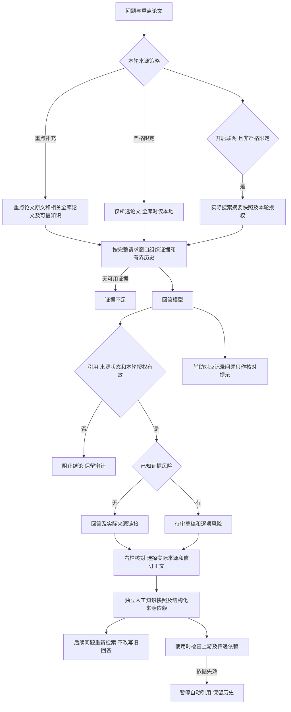

# M04 对话设计与验收契约

更新：2026-10-24。本文维护当前 chat 契约；实施顺序以[实现计划](实现计划.md)为准，整体能力和验证以[当前状态](当前实现与验收状态.md)为准。历史实测另列，不以新规则改写旧结果。

## 产品边界

Chat 综合本地可引用论文、人工确认的可信知识和本轮实际取得的联网证据。来源可追溯、来源类型、审核状态和材料范围必须可见。人工确认表示接受当前知识快照，不等于客观真实性认证；普通 QA 没有全陈述机器蕴含保证。

“本轮外部证据可以引用”与“进入可信知识库”是两种许可。搜索摘要可作明确标识的本轮来源，不能冒充网页正文、论文全文或已经审核的可信知识。未实际取得的网页不能由模型凭 URL 或训练记忆补写。

## 当前完整流程

联网失败时保留独立失败提示，可继续依据本地材料回答；本地也无证据则拒答。搜索失败、无结果、模型失败、错误引用、窗口不足分别记录。用户开启联网才搜索；明确严格限定的请求不进行联网补充。

## 范围：重点与严格限定

- 默认选择论文/分组表示研究重点，优先取得这些论文的当前材料，同时检索相关全库论文和人工确认知识。原文装得下则提供完整当前材料；是否装得下包含补充证据与完整消息预算，超窗仍有片段/章节/概览兜底。
- 来源使用控件可选择“重点补充”或“仅限所选文献”。全库下的严格模式仅使用本地可引用论文和知识。
- 明确的“仅依据/只根据/only use”等请求按严格限制执行。自然语言识别是有限确定性规则，复杂表达不承诺全面理解；控件可明确表达限制。“不要只依据”不按该限制处理。
- 未知、已删除的选择报错；显式空列表仍表示未选任何文献，不静默扩为全库或联网。范围/策略在每轮保存快照，修改不影响历史。
- Web chat 使用上述混合策略；QA 内核显式 paper_ids 的默认严格行为保留，以免 CLI/MCP/旧调用方无意扩大范围。其他任务不因本次修改自动获得混合联网能力。

## 本轮联网证据与来源展示

当前普通网页接口仍只有 Tavily 的标题、URL 和搜索摘要，include_raw_content=False，未自动抓网页正文。论文发现/arXiv 全文获取仍是 M01/M02 的独立路径。

新聊天从实际搜索结果创建不可变 pending 快照，使用 chat_evidence_grants 记录来源、内容哈希、会话、用户消息、查询和取得时间。仅内部从真实搜索结果登记，不接受请求或模型自行指定待审来源列表。重复发布/精确响应复用沿用同一授权，不重复搜索。

给模型的每个片段带实际类型与审核状态；稳定 P 编号统一定位各类证据，区别由程序元数据、正文提示及回复来源标签表达，无需模型编页码。点击后右栏展示 URL、快照文本、审核状态与取得时间。原文属于历史材料时，程序标出历史依据。给模型的网页片段是证据数据，不构成可执行指令。

本轮授权仅由聊天及其审核回溯专用检查使用，不放宽普通导出/其他任务；即使携带授权字段，普通来源守卫仍拒绝 pending。

本轮授权不改变全库准入：普通检索、其他会话和无授权导出不能引用 pending 来源。重开原回复可凭原授权查看和核验快照；拒绝/撤销、内容或地址变化后不再可引用。网页临时无法访问不抹去已保存快照，也不自动表示原文错误。

模型须区分原文事实、作者主张、自己的推断及来源冲突，不能一律以本地资料压过新网页；通用冲突语义仍需人工核对，不能把提示要求计为自动验收通过。

## 人工修订与知识依赖

新 Web 回复与 qr_ 审核快照在同一事务保存。快照冻结原问题/范围/草稿和实际送达来源、材料版本、内容哈希及原句对应记录。旧消息不猜测补建当时未保存的信息。

用户选择支持修订正文的来源，编辑正文和核对依据，确认后生成独立人工知识。只有人工修订正文进入检索块；完整上游文本、审核说明与追溯信息保存在不可变审计内容及结构化依赖中，不能把未审核的附带原句或说明一起升级为知识事实。实际取得的 pending 搜索摘要也可以供本次人工核对：仅确认该知识所使用的依据，不顺带确认整份网页进入全库。错页、未知编号、来源失效不能直接确认。版本哈希与最后审核记录用于并发检查；拒绝/撤销不覆写原生成。

人工裁决后原回答及覆盖它的旧摘要退出后续上下文。新知识参与下一轮正常检索，包括仍以原论文为重点的会话；严格仅限论文时保留限制。检索仍受相关性和窗口约束，不承诺每条新知识必定命中，不把修订文本直接塞进偏好或当成新的系统指令。

派生知识使用 evidence_lineage 保存所选来源的稳定 ID、材料/内容哈希、地址以及本次人工接受 pending 网页依据的记录。解读/对比人工知识使用同一机制。使用时检查传递依赖，不改写人工确认历史：

| 变化 | 当前行为 |
|---|---|
| 上游回收、撤销可信状态、拒绝，或内容/归属变化 | effective_status=needs_review，暂停检索/引用；右栏仍可看原知识和依赖，原人工审核保留 |
| 原文出现新材料版本 | 标记 historical，保留可回溯历史依据并提示不能当作当前版本结论，不宣布旧知识错误 |
| 原网页临时不可访问 | 不主动联网重验或销毁快照；可访问性与已存证据有效性分开 |
| 上游知识间接依赖失效 | 沿结构化依赖传播到下游可用性，独立知识不受影响 |
| 旧派生知识无结构化依赖 | 不从正文猜关系；明确待重新核对，普通手工独立知识不因此被误判 |

当前以“一次人工确认生成的独立知识”为依赖单位。多个来源中一个失效时列出受影响依据，不自动猜测其余来源足以替代；可根据当前原文重新提问、在右栏生成修订知识，并撤销旧条目。尚未实现任意长知识条目内部的逐句依赖替代或自动更新旧陈述。

来源失效也会隔离引用它的旧回答和覆盖它的旧摘要；历史记录不删除。失效来源链接可以保留为“仅回溯”，不能继续呈现为可用事实依据。

## 引用检查、原句对应与错误分级

模型提出 evidence_map 的 claim/subject/basis/sources/quotes。程序只校验正文与来源位置，不认证蕴含、对象归属、陈述完整覆盖或论文没有某项信息。没有定位到与原文未说明不同；没有损失公式也不代表没有训练目标信息。

| 类型 | 处理 |
|---|---|
| 正文虚构编号、错误页码、来源失效或记忆冒充证据 | invalid_citation，阻止结论；实际来源和历史内容仅供审计 |
| 明确否定/表格归属、已覆盖条件错配、已知材料说明错误、给出的原句不可定位 | needs_review，保留逐项风险与原稿，不进入后续事实输入 |
| 辅助记录结构走形、未完整复制正文、缺对象/类型/原句等 | audit_warnings，不据此判定正文错误，不单独阻断原本来源有效的回答 |
| 空白、PDF 连字、软连字符和明确行末连字符差异 | 有界排版等价定位，保存原文真实切片/位置并提示；不改数字、否定词或对象，不拼邻块纠错 |

原句错误记录到具体陈述。当前对已识别证据风险仍保守隔离整答，尚未可靠划分影响范围时不自动删句或重写出一份“修复后答案”；逐句局部放行仍待专项验证。辅助记录缺项不会因“提供了记录”反而比完全没记录更容易整答阻断。无论 answered 或原句可定位，都不代表全部语义通过。

refused（证据不足）、error（服务/回答结构失败）、budget_exceeded（最小请求装不下）继续单独处理。思考只在服务返回后折叠展示，不作证据或后续事实输入；没有逐 token 流式。

## 持久请求、接口与备份

新 Web chat 使用持久请求：登记调用意图、先保存响应和用量、再原子发布。刷新/重启不自动重发；失败/未知尝试须明确允许重试，精确成功响应可复用。混合取证的真实搜索响应也保留，发布失败后不重复搜索或模型请求。本轮搜索来源在中断期间撤回则恢复进入stale，要求重新提问，不重发搜索或模型。来源/历史/模型/实现绑定、未知费用和取消边界保留，见[持久化契约](N04对话请求持久化与续验-2026-10-23.md)。旧 chat API 仍为兼容入口，未自动获得持久恢复。

GET /api/chat-reviews/{rid} 查看审核快照，POST /api/chat-reviews/{rid}/review 提交人工裁决。GET /api/evidence/{ref} 返回原始审核状态、effective_status、dependency_status、取得时间（适用时）；审核和撤销继续复用已有入口。scope.mode=focus/strict，省略默认 focus；每轮 scope_snapshot.strict 记录实际限制，audit_warnings 与 guard_issues 分开。

schema v15 新增 evidence_lineage 和 chat_evidence_grants；N08 完整保留并校验往返。v14/v13 旧归档先用匹配版本恢复再迁移，不能直接作为 v15 归档恢复。只测试隔离数据根，没有迁移用户日常库。

## 验收工具口径

`tools/chat_acceptance.py` 默认 stub，真实模式须明确授权并使用隔离根。它仍测试 QA 内核，不自动覆盖 Web 的混合取证/临时授权和压缩全过程；新的真实混合质量应固定 Web 入口验收。

v3 引用计分按草稿实际出现的唯一编号/物理页对，不按召回列表计命中；失效、虚构和错页计入失败。范围有效性、回答可用性、应拒答率、真实追问和跨论文覆盖分别报告。追问须实际保存父轮历史，不能只复用会话 ID；这些结构性指标都不能代替语义正确率。

每轮冻结材料/问题/代码和参数，保留所有失败、原始响应、实际来源、用量和未知费用，不覆盖旧文件或反复补跑挑成功。回放不是新模型质量样本，既有直接内核工具的严格范围分数不能作为默认重点补充策略的 Web 范围验收。

## 验收与历史边界

本轮改前1157项，改后完整1196项通过（1个第三方弃用警告，无 skipped），新增39条回归。包括混合取证、严格/自然语言范围、空选择、拒绝任意待审来源注入、授权篡改、确认后同会话重检索、传递撤销、旧依赖未知、历史版本、上下文/摘要隔离、搜索/模型响应精确复用、备份往返和辅助记录分级。原严格范围测试明确选择严格模式，旧“搜索摘要完全不能参与本轮回答”的断言按新用户需求更新，仍保留不自动全库入库断言。

无窗口工作流覆盖来源策略保存/重开、搜索摘要标识/时间、右栏确认、同会话新知识回答、上游拒绝后派生知识失效与历史回溯，以及既有审核撤销、持久请求、备份、材料版本、主题与850px窄屏。实际证据根以当前状态页为准。本轮没有真实付费搜索/模型调用，不能推断真实联网质量已验收。

历史结果分别保留：[原四篇24题](N04真实对话验收-2026-10-21.md)、[反例修复与复验](N04反例修复与复验-2026-10-22.md)、[冻结版24题](N04冻结版24题验收-2026-10-23.md)、[原句对应两题](N04陈述原句对应与定向复验-2026-10-24.md)。后者记录当时仅空白等价、辅助记录可整答阻断的旧规则，本轮修订不回写当时模型输出或质量结论。

下一步先验收真实混合来源、冲突/时效与人工修订质量，再决定是否扩大长会话；F3/打包、D3、本地 embedding 继续暂停。

零调用原响应回放：`_selftest.n04-mixed-evidence-offline-20261024/` 只读上一轮x1/x2原始响应和来源。x1排版/辅助抄写问题降为提示，P77实际错绑仍阻止；模型原输出与旧结果哈希不变，不计为新生成质量样本。
