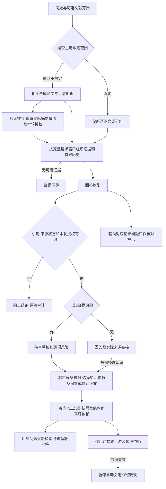
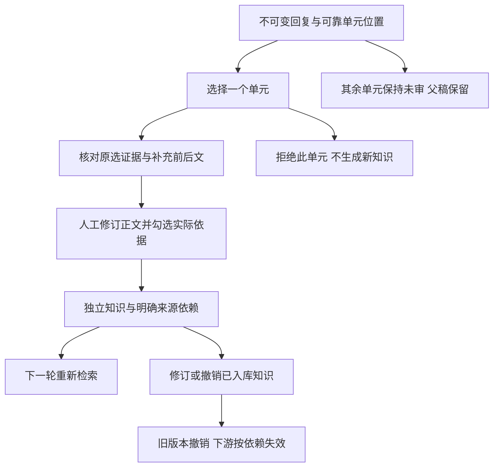

# M04 对话设计与验收契约

更新：2026-10-24。本文维护当前 chat 契约；实施顺序以[实现计划](实现计划.md)为准，整体能力和验证以[当前状态](当前实现与验收状态.md)为准。历史实测另列，不以新规则改写旧结果。

## 产品边界

Chat 综合本地可引用论文、人工确认的可信知识和本轮实际取得的联网证据。来源可追溯、来源类型、审核状态和材料范围必须可见。人工确认表示接受当前知识快照，不等于客观真实性认证；普通 QA 没有全陈述机器蕴含保证。

“本轮外部证据可以引用”与“进入可信知识库”是两种许可。搜索摘要可作明确标识的本轮来源，不能冒充网页正文、论文全文或已经审核的可信知识。未实际取得的网页不能由模型凭 URL 或训练记忆补写。

## 当前完整流程

联网失败时保留独立失败提示，可继续依据本地材料回答；本地也无证据则拒答。搜索失败、无结果、模型失败、错误引用、窗口不足分别记录。当前Web界面默认请求联网；主动限定范围或明确限制来源的请求不联网。旧API仍可显式传web_search=false，不将离线验收变成真实搜索。

## 范围：默认综合与可选限定

- 新会话默认综合相关全库论文、人工确认知识与本轮实际取得的联网搜索摘要。全库检索不等于把所有论文全文全部发送；按问题取得相关证据并明确来源。
- 界面只保留回答范围选择。主动选择论文/分组或“就这篇提问”时，仅使用该范围，不额外联网或扩到其他知识。选定论文的当前材料装得下则完整提供；完整消息超窗仍保留片段/章节/概览兜底。取消限定后恢复全库与联网。
- 明确的“仅依据/只根据/only use”等请求按严格限制执行。自然语言识别是有限确定性规则，复杂表达不承诺全面理解；控件可明确表达限制。“不要只依据”不按该限制处理。
- 未选论文（省略、null、空对象或 `paper_ids: []`）表示不限定论文。新Web界面发web_search=true；旧请求/精确续验仍保留原值，显式false仍可离线。
- 未知、已删除的文献/分组报错，不静默变全库。明确选择的空分组仍是实际分组过滤，不等于没有选择。范围/策略每轮保存快照，修改不影响旧消息或旧审核。
- “只用左侧上下文”等内容描述不构成来源限定；自然语言严格限制须能识别为针对来源的指令。
- 历史重点/仅本地会话及API的focus/strict字段保留兼容，不批量修改已有scope或待续请求。旧界面范围在顶部标为“原重点/原设置”，重新保存范围后采用现行两种选择。QA内核/CLI/MCP行为不自动改写，其他任务不因此自动联网。

## 本轮联网证据与来源展示

当前普通网页接口仍只有 Tavily 的标题、URL 和搜索摘要，include_raw_content=False，未自动抓网页正文。论文发现/arXiv 全文获取仍是 M01/M02 的独立路径。

新聊天从实际搜索结果创建不可变 pending 快照，使用 chat_evidence_grants 记录来源、内容哈希、会话、用户消息、查询和取得时间。仅内部从真实搜索结果登记，不接受请求或模型自行指定待审来源列表。重复发布/精确响应复用沿用同一授权，不重复搜索。

给模型的每个片段带实际类型与审核状态；稳定 P 编号统一定位各类证据，区别由程序元数据、正文提示及回复来源标签表达，无需模型编页码。点击后右栏展示 URL、快照文本、审核状态与取得时间。原文属于历史材料时，程序标出历史依据。给模型的网页片段是证据数据，不构成可执行指令。

本轮授权仅由聊天及其审核回溯专用检查使用，不放宽普通导出/其他任务；即使携带授权字段，普通来源守卫仍拒绝 pending。

本轮授权不改变全库准入：普通检索、其他会话和无授权导出不能引用 pending 来源。重开原回复可凭原授权查看和核验快照；拒绝/撤销、内容或地址变化后不再可引用。网页临时无法访问不抹去已保存快照，也不自动表示原文错误。

模型须区分原文事实、作者主张、自己的推断及来源冲突，不能一律以本地资料压过新网页；通用冲突语义仍需人工核对，不能把提示要求计为自动验收通过。

## 人工修订与知识依赖

新 Web 回复与 qr_ 审核快照在同一事务保存。快照冻结原问题/范围/草稿和实际送达来源、材料版本、内容哈希及原句对应记录。旧消息不猜测补建当时未保存的信息。

用户选择支持修订正文的来源，编辑正文和核对依据，确认后生成独立人工知识。只有人工修订正文进入检索块；完整上游文本、审核说明与追溯信息保存在不可变审计内容及结构化依赖中，不能把未审核的附带原句或说明一起升级为知识事实。实际取得的 pending 搜索摘要也可以供本次人工核对：仅确认该知识所使用的依据，不顺带确认整份网页进入全库。错页、未知编号、来源失效不能直接确认。版本哈希与最后审核记录用于并发检查；拒绝/撤销不覆写原生成。

人工裁决后原回答及覆盖它的旧摘要退出后续上下文。新知识参与下一轮正常检索，包括仍以原论文为重点的会话；严格仅限论文时保留限制。检索仍受相关性和窗口约束，不承诺每条新知识必定命中，不把修订文本直接塞进偏好或当成新的系统指令。

派生知识使用 evidence_lineage 保存所选来源的稳定 ID、材料/内容哈希、地址以及本次人工接受 pending 网页依据的记录。解读/对比人工知识使用同一机制。使用时检查传递依赖，不改写人工确认历史：

| 变化 | 当前行为 |
|---|---|
| 上游回收、撤销可信状态、拒绝，或内容/归属变化 | effective_status=needs_review，暂停检索/引用；右栏仍可看原知识和依赖，原人工审核保留 |
| 原文出现新材料版本 | 标记 historical，保留可回溯历史依据并提示不能当作当前版本结论，不宣布旧知识错误 |
| 原网页临时不可访问 | 不主动联网重验或销毁快照；可访问性与已存证据有效性分开 |
| 上游知识间接依赖失效 | 沿结构化依赖传播到下游可用性，独立知识不受影响 |
| 旧派生知识无结构化依赖 | 不从正文猜关系；明确待重新核对，普通手工独立知识不因此被误判 |

当前以“一次人工确认生成的独立知识”为依赖单位。多个来源中一个失效时列出受影响依据，不自动猜测其余来源足以替代；可根据当前原文重新提问、在右栏生成修订知识，并撤销旧条目。尚未实现任意长知识条目内部的逐句依赖替代或自动更新旧陈述。

来源失效也会隔离引用它的旧回答和覆盖它的旧摘要；历史记录不删除。失效来源链接可以保留为“仅回溯”，不能继续呈现为可用事实依据。

## 引用检查、原句对应与错误分级

模型提出 evidence_map 的 claim/subject/basis/sources/quotes。程序只校验正文与来源位置，不认证蕴含、对象归属、陈述完整覆盖或论文没有某项信息。没有定位到与原文未说明不同；没有损失公式也不代表没有训练目标信息。

| 类型 | 处理 |
|---|---|
| 正文虚构编号、错误页码、来源失效或记忆冒充证据 | invalid_citation，阻止结论；实际来源和历史内容仅供审计 |
| 明确否定/表格归属、已覆盖条件错配、已知材料说明错误、给出的原句不可定位 | needs_review，保留逐项风险与原稿，不进入后续事实输入 |
| 辅助记录结构走形、未完整复制正文、缺对象/类型/原句等 | audit_warnings，不据此判定正文错误，不单独阻断原本来源有效的回答 |
| 空白、PDF 连字、软连字符和明确行末连字符差异 | 有界排版等价定位，保存原文真实切片/位置并提示；不改数字、否定词或对象，不拼邻块纠错 |
| 程序获取时间、来源说明、历史依据标签 | 仅与实际送达来源的完整程序字段匹配，记为 program_metadata，右栏标明非论文原句；不冒用正文偏移、不认证论文结论 |

回答正文允许忠实转述，不要求与论文逐字一致。严格定位针对模型在 quotes 中声称复制的原文；可只选择同一块内支持结论的短语/短分句，不必重抄整段。跨块依据须分别引用、分别摘原文；缺失的连字符不由模型自行“纠正”。程序记录可用 metadata 类型，旧模型把它标成 direct 时也仅按程序实际字段识别并提示；虚构值、日期数字改变和只摘部分字段不能绕过校验。

原句错误记录到具体陈述。当前对已识别证据风险仍保守隔离整答，尚未可靠划分影响范围时不自动删句或重写出一份“修复后答案”；逐句局部放行仍待专项验证。辅助记录缺项不会因“提供了记录”反而比完全没记录更容易整答阻断。无论 answered 或原句可定位，都不代表全部语义通过。

refused（证据不足）、error（服务/回答结构失败）、budget_exceeded（最小请求装不下）继续单独处理。思考只在服务返回后折叠展示，不作证据或后续事实输入；没有逐 token 流式。

## 持久请求、接口与备份

新 Web chat 使用持久请求：登记调用意图、先保存响应和用量、再原子发布。刷新/重启不自动重发；失败/未知尝试须明确允许重试，精确成功响应可复用。混合取证的真实搜索响应也保留，发布失败后不重复搜索或模型请求。本轮搜索来源在中断期间撤回则恢复进入stale，要求重新提问，不重发搜索或模型。来源/历史/模型/实现绑定、未知费用和取消边界保留，见[持久化契约](N04对话请求持久化与续验-2026-10-23.md)。旧 chat API 仍为兼容入口，未自动获得持久恢复。

GET /api/chat-reviews/{rid} 查看审核快照，POST /api/chat-reviews/{rid}/review 提交人工裁决。GET /api/evidence/{ref} 返回原始审核状态、effective_status、dependency_status、取得时间（适用时）；审核和撤销继续复用已有入口。scope.mode=focus/strict，省略默认 focus；每轮 scope_snapshot.strict 记录实际限制，audit_warnings 与 guard_issues 分开。

schema v15 新增 evidence_lineage 和 chat_evidence_grants；N08 完整保留并校验往返。v14/v13 旧归档先用匹配版本恢复再迁移，不能直接作为 v15 归档恢复。只测试隔离数据根，没有迁移用户日常库。

## 验收工具口径

`tools/chat_acceptance.py` 默认 stub，真实模式须明确授权并使用隔离根。它仍测试 QA 内核，不自动覆盖 Web 的混合取证/临时授权和压缩全过程；新的真实混合质量应固定 Web 入口验收。

v3 引用计分按草稿实际出现的唯一编号/物理页对，不按召回列表计命中；失效、虚构和错页计入失败。范围有效性、回答可用性、应拒答率、真实追问和跨论文覆盖分别报告。追问须实际保存父轮历史，不能只复用会话 ID；这些结构性指标都不能代替语义正确率。

每轮冻结材料/问题/代码和参数，保留所有失败、原始响应、实际来源、用量和未知费用，不覆盖旧文件或反复补跑挑成功。回放不是新模型质量样本，既有直接内核工具的严格范围分数不能作为默认重点补充策略的 Web 范围验收。

## 验收与历史边界

本轮改前1157项，改后完整1196项通过（1个第三方弃用警告，无 skipped），新增39条回归。包括混合取证、严格/自然语言范围、空选择、拒绝任意待审来源注入、授权篡改、确认后同会话重检索、传递撤销、旧依赖未知、历史版本、上下文/摘要隔离、搜索/模型响应精确复用、备份往返和辅助记录分级。原严格范围测试明确选择严格模式，旧“搜索摘要完全不能参与本轮回答”的断言按新用户需求更新，仍保留不自动全库入库断言。

无窗口工作流覆盖来源策略保存/重开、搜索摘要标识/时间、右栏确认、同会话新知识回答、上游拒绝后派生知识失效与历史回溯，以及既有审核撤销、持久请求、备份、材料版本、主题与850px窄屏。实际证据根以当前状态页为准。本轮没有真实付费搜索/模型调用，不能推断真实联网质量已验收。

历史结果分别保留：[原四篇24题](N04真实对话验收-2026-10-21.md)、[反例修复与复验](N04反例修复与复验-2026-10-22.md)、[冻结版24题](N04冻结版24题验收-2026-10-23.md)、[原句对应两题](N04陈述原句对应与定向复验-2026-10-24.md)。后者记录当时仅空白等价、辅助记录可整答阻断的旧规则，本轮修订不回写当时模型输出或质量结论。

后续固定12轮真实模型与实际网页快照回放已执行，4满足/6待核/1范围策略失败/1服务失败，整体未通过；该12轮未使用真实Tavily。随后在主工作区找到已有搜索配置，另两条生产搜索API与待审落库核验通过，未新增模型调用，混合回答质量结论不变。新知识重检索、上游失效隔离、材料历史和响应零重发有记录，但“只用左侧上下文”误触发严格范围、跨对象材料覆盖、程序元数据作为原句及跨块/排版引句仍需修。新增6条验收工具回归，当前完整1202项通过，详见[混合来源固定验收](N04混合来源固定验收-2026-10-24.md)。下一步先做这些实际反例的离线修复，再决定定向复验和长会话；F3/打包、D3、本地 embedding 继续暂停。

零调用原响应回放：`_selftest.n04-mixed-evidence-offline-20261024/` 只读上一轮x1/x2原始响应和来源。x1排版/辅助抄写问题降为提示，P77实际错绑仍阻止；模型原输出与旧结果哈希不变，不计为新生成质量样本。

随后按用户澄清改正了空选择语义及内容方向误判，并将程序记录从论文原句核对中分离。`_selftest.n04-scope-audit-fix-20261024/` 零调用回放原12轮：m2/v2程序字段误拦解除；v1/p1/u1未匹配引句和旧x1的P77错绑仍待审，原输出不改。无窗口UI已验证空选择实际进行联网、右栏程序记录标签、审核/撤销与重开。跨对象全文/摘要误拦及可靠局部审核仍待修，真实质量未新增通过结论。

本次修订完整1220项通过（改前1202，新增18条，1个第三方弃用警告、无skipped）。旧s2拒答按当时规则记录，现行合同不再以空选择拒答为正确结果。当前验收题集v2已反映新含义，原冻结副本和结果保持不变。

## 后续实现：逐对象完整度与锚点小范围试验

材料说明检查使用本轮实际来源清单，按明确标题/标题缩写绑定对象：Transformer全文不意味着BERT摘要也具有全文。明确全局“本轮只有摘要”仍会与已送达全文核对；无法识别所谈对象时不套用其他论文的完整度，也不宣称该说明已被语义认证。原a1回放中的跨对象误拦已解除，不重新生成或回写原回答。

`qa.evidence_anchor_trial` 为默认false的内部试验标志，无设置界面；普通聊天继续使用原quotes路径。仅在隔离试验中，程序为已送达原文生成短句/短段锚点目录，模型可返回 `{"source":"P1","anchor_id":"qa2_…"}`。原文正文、全文前缀与窗口预算仍保留，目录也计入实际输入预算；不增加模型复核请求。旧 `qa_…` 段落ID只用于兼容原选择的回溯，不再出现在新目录中。

锚点ID绑定块/来源、材料版本、物理页、全文哈希及字符区间，与临时P编号无关。v2在原段落内按确定性标点边界切分，保留PDF换行、连字符、原始字符及偏移，避开常见缩写/小数；长范围拆为不超过360字符的短段，并标记前后延续。360是定位单元大小，不是任务或模型输出上限。它不是通用句法分析或语义完整认证；需要多句/多块时分别选择多个锚点，不拼接成不存在的原句。服务端验证属于指定来源的冻结内容后回填原文，不接受模型提供的原文/页码覆盖；任意源、版本、内容变化使旧锚点无效。附带旧式quote仍须在所选范围内定位，不能掩盖已知错引。新协议记为 `anchors_trial_v2`，原段落范围回放时明确标为legacy。

实际回填及来源引用照常保存到回复不可变审核快照，并参与来源失效、人工确认/撤销与恢复检查。切换试验协议会拒绝恢复旧请求，不自动重发。右栏显示“试验锚点 · 程序回填原文，语义待核对”。有效锚点仍可能选错对象，`semantic_status`保持unreviewed，不承诺自动支持或局部放行。

离线对照工具为 `tools/anchor_trial_acceptance.py`。本轮对原12轮中有审核快照的10份回复，仅转换独立可定位的65处原引句；未定位引句保持旧检查。v1/p1/u1原阻断项和旧x1/P77错绑仍保留。另一个明确标为“脚本选择同一来源”的控制例验证无需复制连字符也能回填原文，但不是新模型生成样本，不能据此修改原实测结论。结果仅留 `_selftest.n04-anchor-comparison-verified-20261024/`，零模型调用，默认协议未切换。

后续真实验证结论见[原句/锚点固定对照](N04锚点真实对照验收-2026-10-24.md)：12答、14真实模型调用（12qa+2expand，初始估算漏计），五组实际材料一致，s2非配对单列。有效对照71/71锚点回填，原句110/114定位；两种模式仍有x1任务集合归属待核，claim与正文精确对应和锚点过粗也未解决。默认仍关闭，不扩大；下一步先补回复句子绑定与细粒度原文锚点，再用旧稿与UI流程检查。新增调用规划与发送前守卫仅属于验收工具，不改变现役聊天行为；最新完整1254项通过，旧失败不回写。

## 回答单元与细锚点的现行实现

上述下一步随后已补齐：QA提示优先返回 `answer_units`，每项只写一份text及subject/basis/sources/quotes；程序将同一text渲染为回答、生成claim，并绑定原回答哈希及字符区间。重复句子按单元位置区分，模型提供的claim副本、ID或偏移不覆盖程序值；冲突的独立正文/映射报错，不静默挑选。不会追加模型请求来重写陈述。旧answer/evidence_map仍兼容，但只做唯一字面对应，改写、内部空白不一致、重复歧义明确未绑定，不模糊补配；辅助对应问题仍仅提示，不把它当成正文错误。

绑定和精细锚点随不可变回复快照保存，持久入口验证/复用同一新结构，发布中断后复用已存响应不重发；代码或协议变化仍拒绝旧请求续验。右栏分别显示已对应回答原文、未绑定/歧义或旧记录未知，短原文可继续跳到完整来源，长段拆分提示查看前后文。旧快照不自动补造绑定，不改变schema v15。

离线回放12答：68条旧陈述可唯一字面绑定，70条保持未绑定；68个回答单元控制仅验证同文渲染，不是模型新生成。122处原本可定位原句的脚本控制，粗段回填100222字符→细段20163字符；原4错引、旧P77及x1语义待核结论均保留。工具 `tools/answer_anchor_offline_acceptance.py`，最终证据 `_selftest.n04-answer-fine-offline-verified-20261024/`，无新增模型调用、不回写原稿。完整1274项与无窗口UI通过；默认关闭锚点，新格式真实模型遵循和独立真人核对耗时仍未验证，不据脚本控制扩大使用。

上述新格式随后进行了三题首次真实验证：3/3使用answer_units，21单元准确绑定、38细锚点有效、27引用解析正确；开发原文审查1满足/1待核/1失败。跨句复合单元漏选同块后一句，x1任务集合错误重现；程序没有自动识别为错误，不能将answered或精确锚点当成语义认证。实际3qa、166918token，无expand/重发/服务失败，细节见[固定报告](N04锚点真实对照验收-2026-10-24.md#后续三题真实验证回答单元与细锚点)。默认仍关闭。后续先按[唯一实施计划](实现计划.md#三题真实验证后的后续顺序2026-10-24现行)明确单元人工裁决/知识依赖，再接右栏单元操作与原选证据/上下文区分；这些功能目前尚未实现。目录输入开销优化另做有界评估，不增加全量复核或削减全文。

## 单元级人工裁决与知识依赖（已实现）

单元ID由原回答哈希/字符范围确定，仅接受唯一且准确的程序绑定，不从旧模糊claim猜测。原回答、原模型选择和父审核快照保持不可变。单元确认、修订、拒绝、撤销各有独立历史与并发令牌；确认一个单元不改变其余单元，也不把父回复标成整答确认。

| 接口 | 行为与边界 |
|---|---|
| GET /api/chat-reviews/{rid} | 增加可靠units及各自裁决/知识有效状态；reviews仍只表示旧整答记录 |
| GET /api/chat-reviews/{rid}/units/{uid} | 原单元/原选证据、修订历史、单元令牌、本轮来源列表；不请求模型 |
| GET /api/chat-reviews/{rid}/units/{uid}/sources/{tag} | 按父来源快照验证当前版本/内容，返回完整前后文及qa2_细范围；补充内容不冒充原模型所选 |
| POST /api/chat-reviews/{rid}/units/{uid}/review | confirm / revise / reject / revoke；确认/修订必须提交人工正文和明确evidence（source、anchor_id），并核对父snapshot_hash、单元review_token |

人工选择只允许父请求实际送达的来源，原句/页码/材料/哈希及当前可信状态都复核；可选原单元没引用但本轮实际送达的来源，以便人工纠正对象/条件关系。每个被引用的来源须有实际勾选的连续范围，所选来源与人工正文编号一致。多个范围分别保存，绝不拼成不存在的原句。前后文与已选证据分开标注，旧段落不自动转换为细句；模型锚点试验开关只控制生成目录，人工选择始终可用。

confirm创建独立知识，只索引人工正文；revise原子撤旧/存新，原审计保留；reject不生成新知识并撤销该单元已有知识；revoke只撤销本单元当前入库，均需理由。失败事务不撤掉原有效版本。被替换或撤销的旧单元知识不能走通用来源confirm恢复，必须回单元入口修订；来源失效时仍可拒绝/撤销。上游撤销、换版历史和下游失效沿用结构化依赖，不靠正文猜关系。

父回复首次裁决选择整答或单元模式，模式互斥，避免两套重叠知识；旧整答模式可继续原入口，旧无位置记录不补造单元。单元模式下父回复/覆盖它的压缩摘要退出事实历史，原稿仍可查看；人审知识通过下一轮正常检索取得。即使已审部分内容，其他单元仍未审，不自动删去坏句后把剩余原答当成事实。

schema维持v15。semantic_reviews以父run_id、父hash、稳定单元claim_id记独立裁决，qud_不可变载荷保存人工所选原文及知识版本，不向父快照追加内容。备份/恢复保留全部审计；通用semantic-run审核不能绕过专用来源校验。

完整1303项、无窗口API/UI通过；旧三题的隔离脚本控制证明simple单独确认、cross_sentence显式补后句、x1拒绝后修订知识、撤销/重检索，而非模型新生成或用户确认。工具 `tools/unit_review_offline_acceptance.py`，最终证据见状态页。修复了FTS/LIKE遗漏material_id导致片段锚点与人工目录不一致；不改变历史ID。自动集合归属语义仍未解决，不据人审闭环默认启用模型锚点。
## 2026-10-24 真人试用后的审核交互修订

首次人工试用发现：单元实际引用P2，但来源选择默认P1；正确原文虽已加载，人工仍要在大块上下文中寻找。单元入口藏在辅助对应记录中，整答表单反而默认展开；单元裁决后主界面又把整答换成占位文字。这些是操作路径和呈现问题，不是证据失效或模型语义验收通过。

现行交互：可靠绑定单元在主对话分别显示原文、状态和核对入口；右栏直接显示单元列表，整答兼容入口折叠。进入单元时先展示当前有效的原选/上次人工所选细原文并预选，正确即可保留；补选同来源前后句和查找其他本轮来源均按需展开，选择器优先本单元相关来源并可筛选编号/标题/页码。

裁决后保留原回答供人阅读，单独展示人工知识，不连带确认兄弟或整答；父答和旧摘要仍退出模型事实历史，后续须重检索。失效来源和原有语义阻断优先，不能以逐条展示恢复被阻止内容。会话列表、定位及消息读取补用已有共享连接锁，避免审核刷新与其他事务交叉读取。验证记录以当前状态页为准，不改旧真实样本数字。

随后用户反馈主对话逐条控制过于分散，现已收回到回复后的单一入口；主区保留连续原答和汇总状态，右栏列出所有条目并在原位展开一条证据/修订表单。只有一份活动表单，确认/修订/拒绝/撤销后刷新汇总，不把其余条目或整答隐式确认为事实。

汇总根据每条当前裁决与知识可用性计算：全部有效确认显示“全部N条已确认入库”；全部处理但含拒绝/撤销显示各项计数；未完显示已处理X/N；存在未绑定正文另行标明，不能冒称整答覆盖。任何人工裁决后原答仍退出模型事实历史，必须重检索；不因完成标签自动恢复原答或旧摘要。

## 多轮历史压缩与当前来源恢复（现行）

追问从最近有效回答恢复已实际引用的来源身份，包括有效压缩块覆盖的原消息；摘要正文不用于构造证据，原回答不重新塞回上下文。论文句柄必须属于当前可信材料；人工知识/已确认网页按source_id和source_kind恢复并重验当前状态。历史待审网页的轮次授权不被继承，须本轮实际取得授权才能使用。恢复知识计入全文预算，严格选择论文范围时不混入知识库或范围外论文。

来源撤回/换版、知识失效或人工裁决排除原回答时，覆盖该回答的摘要同步退出模型上下文；历史记录与压缩块留存，仍能审计还原。重建过去轮次只使用当时已有检查点，未来摘要不能遮住过去消息。模型提示只取检查点的摘要体，历史编号不共享；主聊天隐藏内部检查点，原问答保持可读。

本轮为六轮既有真实历史＋五个新追问的受控压缩，不改1M窗口：983→552估算token，五个句柄恢复；知识确认/修订/撤销及严格范围链路有实际请求证据，撤回/换版/人工否决另用真实历史副本零调用控制。首次结果3answered/2needs_review，24/24编号有效，两个真实引句错绑/改写仍保留，不能称自然长窗口或通用语义通过。详见[多轮受控验收](N04多轮追问与受控压缩验收-2026-10-24.md)。

### 当前原句生成约束

模型输入中每块正文用 `【来源正文 P# 开始】` / `【来源正文 P# 结束】` 明确归属；头部、原文和来源ID不改，界面不展示这些内部边界。生成按先选编号并复制该块连续引句、再写忠实转述的正文、最后核对三处编号组织。即使同篇相邻块也分别列出所需编号和各自引句，不凭语义相近替换原词或跨边界拼接。metadata仍引用完整程序字段，锚点试验保持原目录协议且默认关闭。

边界和提示已计入正常材料装载预算，1M/384K与自动输出不变。原句定位、编号/材料版本校验和待审隔离未放宽；程序不自动修复原答。五份冻结稿的零调用回放保留两处原错引，独立手工控制可定位，不证明新模型已遵循提示或语义通过；详见[离线收尾](N04多轮追问与受控压缩验收-2026-10-24.md#后续引句生成约束与离线收尾)。

已只读核对用户simple样例：原状态answered、0阻断，5条提示均是锚点通用说明，5条人工确认均存在。现在仅把三种已知定位/元数据说明投影为notices；真实错引、错页、未知风险及来源失效不降级，原审核快照不改。普通有效回答无需逐条人审才可使用；人工整理是保存/修订可信知识的可选路径。cross_sentence漏选结论句和x1任务集合归属的旧反例仍保留，不能从simple通过推断全部语义正确。
