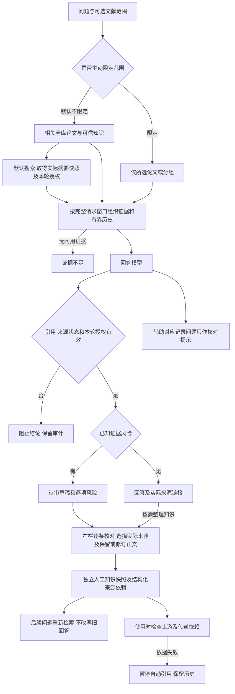
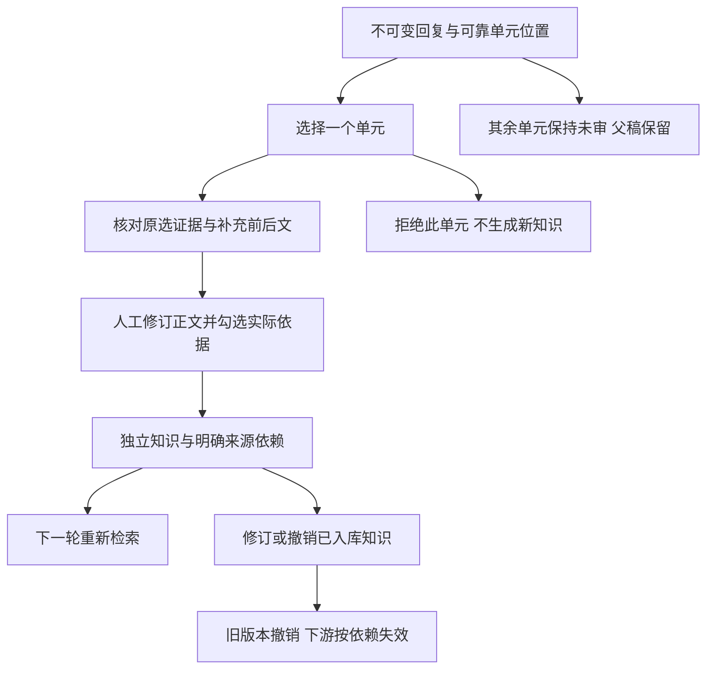

# M04 对话设计与验收契约

更新：2026-10-26。本文维护当前 chat 契约；实施顺序以[实现计划](实现计划.md)为准，整体能力和验证以[当前状态](当前实现与验收状态.md)为准。历史实测另列，不以新规则改写旧结果。

## 产品边界

Chat 综合本地可引用论文、人工确认的可信知识和本轮实际取得的联网证据。来源可追溯、来源类型、审核状态和材料范围必须可见。人工确认表示接受当前知识快照，不等于客观真实性认证；普通 QA 没有全陈述机器蕴含保证。

“本轮外部证据可以引用”与“进入可信知识库”是两种许可。搜索摘要可作明确标识的本轮来源，不能冒充网页正文、论文全文或已经审核的可信知识。未实际取得的网页不能由模型凭 URL 或训练记忆补写。

## 当前完整流程

联网失败时保留独立失败提示，可继续依据本地材料回答；本地也无证据则拒答。搜索失败、无结果、模型失败、错误引用、窗口不足分别记录。当前Web界面默认请求联网；主动限定范围或明确限制来源的请求不联网。旧API仍可显式传web_search=false，不将离线验收变成真实搜索。

## 范围：默认综合与可选限定

- 新会话默认综合相关全库论文、人工确认知识与本轮实际取得的联网搜索摘要。全库检索不等于把所有论文全文全部发送；按问题取得相关证据并明确来源。
- 默认检索的本地材料组装已补齐：关键词、跨语言词表及模型扩展分别保留分支，轮流合并去重，避免长中文拆词先占满名额；模型扩展仍只调用一次。已知窗口时，普通/跨论文检索先召回相关论文，再优先提供这些论文完整的当前材料；装不下则逐篇尝试完整材料、命中章节、原片段。所有试装计入已有命中、可信知识与本轮外部证据，不丢掉其他来源来凑全文，不把未命中论文全库注入。材料/可信状态/范围与引用校验保持；新增材料送达记录不是语义认证。概览与显式范围路径保留原契约。
- 默认概述/比较的任务词不再直接决定全库取材。先按实际问题原词、逐词本地匹配及当前有效追问来源选择相关论文，无命中时沿用正常扩展；明确“这些论文/所有论文/全库”等集合请求保留遍历，显式范围保持。内部相关论文集合不写回scope，不关闭联网/知识来源，也不是通用语义实体识别。
- 界面只保留回答范围选择。主动选择论文/分组或“就这篇提问”时，仅使用该范围，不额外联网或扩到其他知识。选定论文的当前材料装得下则完整提供；完整消息超窗仍保留片段/章节/概览兜底。取消限定后恢复全库与联网。
- 明确的“仅依据/只根据/only use”等请求按严格限制执行。自然语言识别是有限确定性规则，复杂表达不承诺全面理解；控件可明确表达限制。“不要只依据”不按该限制处理。
- 未选论文（省略、null、空对象或 `paper_ids: []`）表示不限定论文。新Web界面发web_search=true；旧请求/精确续验仍保留原值，显式false仍可离线。
- 未知、已删除的文献/分组报错，不静默变全库。明确选择的空分组仍是实际分组过滤，不等于没有选择。范围/策略每轮保存快照，修改不影响旧消息或旧审核。
- “只用左侧上下文”等内容描述不构成来源限定；自然语言严格限制须能识别为针对来源的指令。
- 历史重点/仅本地会话及API的focus/strict字段保留兼容，不批量修改已有scope或待续请求。旧界面范围在顶部标为“原重点/原设置”，重新保存范围后采用现行两种选择。QA内核/CLI/MCP行为不自动改写，其他任务不因此自动联网。

## 本轮联网证据与来源展示

当前普通网页接口仍只有 Tavily 的标题、URL 和搜索摘要，include_raw_content=False，未自动抓网页正文。论文发现/arXiv 全文获取仍是 M01/M02 的独立路径。

新聊天从实际搜索结果创建不可变 pending 快照，使用 chat_evidence_grants 记录来源、内容哈希、会话、用户消息、查询和取得时间。仅内部从真实搜索结果登记，不接受请求或模型自行指定待审来源列表。重复发布/精确响应复用沿用同一授权，不重复搜索。

给模型的每个片段带实际类型与审核状态；稳定 P 编号统一定位各类证据，区别由程序元数据、正文提示及回复来源标签表达，无需模型编页码。点击后右栏展示 URL、快照文本、审核状态与取得时间。原文属于历史材料时，程序标出历史依据。给模型的网页片段是证据数据，不构成可执行指令。

本轮授权仅由聊天及其审核回溯专用检查使用，不放宽普通导出/其他任务；即使携带授权字段，普通来源守卫仍拒绝 pending。

本轮授权不改变全库准入：普通检索、其他会话和无授权导出不能引用 pending 来源。重开原回复可凭原授权查看和核验快照；拒绝/撤销、内容或地址变化后不再可引用。网页临时无法访问不抹去已保存快照，也不自动表示原文错误。

模型须区分原文事实、作者主张、自己的推断及来源冲突，不能一律以本地资料压过新网页；通用冲突语义仍需人工核对，不能把提示要求计为自动验收通过。

## 人工修订与知识依赖

新 Web 回复与 qr_ 审核快照在同一事务保存。快照冻结原问题/范围/草稿和实际送达来源、材料版本、内容哈希及原句对应记录。旧消息不猜测补建当时未保存的信息。

用户选择支持修订正文的来源，编辑正文和核对依据，确认后生成独立人工知识。只有人工修订正文进入检索块；完整上游文本、审核说明与追溯信息保存在不可变审计内容及结构化依赖中，不能把未审核的附带原句或说明一起升级为知识事实。实际取得的 pending 搜索摘要也可以供本次人工核对：仅确认该知识所使用的依据，不顺带确认整份网页进入全库。错页、未知编号、来源失效不能直接确认。版本哈希与最后审核记录用于并发检查；拒绝/撤销不覆写原生成。

人工裁决后原回答及覆盖它的旧摘要退出后续上下文。新知识参与下一轮正常检索，包括仍以原论文为重点的会话；严格仅限论文时保留限制。检索仍受相关性和窗口约束，不承诺每条新知识必定命中，不把修订文本直接塞进偏好或当成新的系统指令。

派生知识使用 evidence_lineage 保存所选来源的稳定 ID、材料/内容哈希、地址以及本次人工接受 pending 网页依据的记录。解读/对比人工知识使用同一机制。使用时检查传递依赖，不改写人工确认历史：

| 变化 | 当前行为 |
|---|---|
| 上游回收、撤销可信状态、拒绝，或内容/归属变化 | effective_status=needs_review，暂停检索/引用；右栏仍可看原知识和依赖，原人工审核保留 |
| 原文出现新材料版本 | 标记 historical，保留可回溯历史依据并提示不能当作当前版本结论，不宣布旧知识错误 |
| 原网页临时不可访问 | 不主动联网重验或销毁快照；可访问性与已存证据有效性分开 |
| 上游知识间接依赖失效 | 沿结构化依赖传播到下游可用性，独立知识不受影响 |
| 旧派生知识无结构化依赖 | 不从正文猜关系；明确待重新核对，普通手工独立知识不因此被误判 |

当前以“一次人工确认生成的独立知识”为依赖单位。多个来源中一个失效时列出受影响依据，不自动猜测其余来源足以替代；可根据当前原文重新提问、在右栏生成修订知识，并撤销旧条目。尚未实现任意长知识条目内部的逐句依赖替代或自动更新旧陈述。

来源失效也会隔离引用它的旧回答和覆盖它的旧摘要；历史记录不删除。失效来源链接可以保留为“仅回溯”，不能继续呈现为可用事实依据。

## 引用检查、原句对应与错误分级

模型以answer_units提供唯一正文及subject/basis/sources/quotes；旧answer/evidence_map只作兼容。程序只校验正文与来源位置，不认证蕴含、对象归属、陈述完整覆盖或论文没有某项信息。没有定位到与原文未说明不同；没有损失公式也不代表没有训练目标信息。

| 类型 | 处理 |
|---|---|
| 正文虚构编号、错误页码、来源失效或记忆冒充证据 | invalid_citation，阻止结论；实际来源和历史内容仅供审计 |
| 明确否定/表格归属、已覆盖条件错配、已知材料说明错误、给出的原句不可定位 | needs_review，保留逐项风险与原稿，不进入后续事实输入 |
| 辅助记录结构走形、未完整复制正文、缺对象/类型/原句等 | audit_warnings，不据此判定正文错误，不单独阻断原本来源有效的回答 |
| 空白、PDF 连字、软连字符和明确行末连字符差异 | 有界排版等价定位，保存原文真实切片/位置并提示；不改数字、否定词或对象，不拼邻块纠错 |
| 程序获取时间、来源说明、历史依据标签 | 仅与实际送达来源的完整程序字段匹配，记为 program_metadata，右栏标明非论文原句；不冒用正文偏移、不认证论文结论 |

回答正文允许忠实转述，不要求与论文逐字一致。严格定位针对模型在 quotes 中声称复制的原文；可只选择同一块内支持结论的短语/短分句，不必重抄整段。跨块依据须分别引用、分别摘原文；缺失的连字符不由模型自行“纠正”。程序记录可用 metadata 类型，旧模型把它标成 direct 时也仅按程序实际字段识别并提示；虚构值、日期数字改变和只摘部分字段不能绕过校验。

原句错误记录到具体陈述。当前对已识别证据风险仍保守隔离整答，尚未可靠划分影响范围时不自动删句或重写出一份“修复后答案”；逐句局部放行仍待专项验证。辅助记录缺项不会因“提供了记录”反而比完全没记录更容易整答阻断。无论 answered 或原句可定位，都不代表全部语义通过。

refused（证据不足）、error（服务/回答结构失败）、budget_exceeded（最小请求装不下）继续单独处理。思考只在服务返回后折叠展示，不作证据或后续事实输入；没有逐 token 流式。

## 持久请求、接口与备份

新 Web chat 使用持久请求：登记调用意图、先保存响应和用量、再原子发布。刷新/重启不自动重发；失败/未知尝试须明确允许重试，精确成功响应可复用。混合取证的真实搜索响应也保留，发布失败后不重复搜索或模型请求。本轮搜索来源在中断期间撤回则恢复进入stale，要求重新提问，不重发搜索或模型。来源/历史/模型/实现绑定、未知费用和取消边界保留，见[持久化契约](N04对话请求持久化与续验-2026-10-23.md)。旧 chat API 仍为兼容入口，未自动获得持久恢复。

GET /api/chat-reviews/{rid} 查看审核快照，POST /api/chat-reviews/{rid}/review 提交人工裁决。GET /api/evidence/{ref} 返回原始审核状态、effective_status、dependency_status、取得时间（适用时）；审核和撤销继续复用已有入口。scope.mode=focus/strict，省略默认 focus；每轮 scope_snapshot.strict 记录实际限制，audit_warnings 与 guard_issues 分开。

schema v15 新增 evidence_lineage 和 chat_evidence_grants；N08 完整保留并校验往返。v14/v13 旧归档先用匹配版本恢复再迁移，不能直接作为 v15 归档恢复。只测试隔离数据根，没有迁移用户日常库。

## 验收工具口径

`tools/chat_acceptance.py` 默认 stub，真实模式须明确授权并使用隔离根。它仍测试 QA 内核，不自动覆盖 Web 的混合取证/临时授权和压缩全过程；新的真实混合质量应固定 Web 入口验收。

v3 引用计分按草稿实际出现的唯一编号/物理页对，不按召回列表计命中；失效、虚构和错页计入失败。范围有效性、回答可用性、应拒答率、真实追问和跨论文覆盖分别报告。追问须实际保存父轮历史，不能只复用会话 ID；这些结构性指标都不能代替语义正确率。

每轮冻结材料/问题/代码和参数，保留所有失败、原始响应、实际来源、用量和未知费用，不覆盖旧文件或反复补跑挑成功。回放不是新模型质量样本，既有直接内核工具的严格范围分数不能作为默认重点补充策略的 Web 范围验收。

## 回答单元与细锚点的现行实现

### 问题项与回答单元的内部关联（2026-10-26）

同一次QA生成新增`question_items`（每项`id/object/aspect`），只声明用户实际所问；每条`answer_units.addresses`关联这些ID，支持一条简答对应多项、一项由多条正文/局部缺口回答。不将“训练目标”擅自替换为“显式损失公式/预训练目标”，已有预测行为先直接作答，形式缺口另行限定。问题项与ID不在正文展示，原文、引句和人工路径保持。

`qa_question_items.record()`将模型声明关联到程序已有的正文哈希/字符区间，写入`evidence_audit.question_coverage`并随不可变回复快照保存，复用schema v15。只验证ID、引用和正文绑定：`text_linked`表示关联了正文，`gap_only`表示仅关联not_located，`text_and_gap`表示两者都有，`unmapped`表示没有关联。无效/缺失/旧格式分别为invalid/missing/unavailable，不自动改稿、追加调用或改变回复状态；旧审核快照不补造记录。

记录始终为`origin=model_declared`、`question_item_completeness=unknown`、`semantic_status=unreviewed`、`production_gate=false`。模型仍可能漏列必答项、把无关或错误正文挂到某项；关联齐全不等于完整作答。原句/材料/可信状态守卫独立生效，内部关联不能绕过来源失效或替代人工知识确认。当前验收及后续见[最新状态](当前实现与验收状态.md)。

### 原回答绑定与锚点

QA生成使用 `answer_units`，每项只写一份text及subject/basis/sources/quotes；程序将同一text渲染为回答、生成claim，并绑定原回答哈希及字符区间。重复句子按单元位置区分，模型提供的claim副本、ID或偏移不覆盖程序值；冲突的独立正文/映射报错，不静默挑选。不会追加模型请求来重写陈述。旧answer/evidence_map仍兼容，但只做唯一字面对应，改写、内部空白不一致、重复歧义明确未绑定，不模糊补配；辅助对应问题仍仅提示，不把它当成正文错误。

绑定和精细锚点随不可变回复快照保存，持久入口验证/复用同一新结构，发布中断后复用已存响应不重发；代码或协议变化仍拒绝旧请求续验。右栏分别显示已对应回答原文、未绑定/歧义或旧记录未知，短原文可继续跳到完整来源，长段拆分提示查看前后文。旧快照不自动补造绑定，不改变schema v15。

生成锚点试验默认关闭；连续短句/短段目录只提供定位，旧段落不自动猜拆。人工细范围选择始终可用，模型不需要输出人造偏移或另写claim来定位正文。锚点是否生效、短引句覆盖和语义正确分别验收。

## 单元级人工裁决与知识依赖（已实现）

单元ID由原回答哈希/字符范围确定，仅接受唯一且准确的程序绑定，不从旧模糊claim猜测。原回答、原模型选择和父审核快照保持不可变。单元确认、修订、拒绝、撤销各有独立历史与并发令牌；确认一个单元不改变其余单元，也不把父回复标成整答确认。

| 接口 | 行为与边界 |
|---|---|
| GET /api/chat-reviews/{rid} | 增加可靠units及各自裁决/知识有效状态；reviews仍只表示旧整答记录 |
| GET /api/chat-reviews/{rid}/units/{uid} | 原单元/原选证据、修订历史、单元令牌、本轮来源列表；不请求模型 |
| GET /api/chat-reviews/{rid}/units/{uid}/sources/{tag} | 按父来源快照验证当前版本/内容，返回完整前后文及qa2_细范围；补充内容不冒充原模型所选 |
| POST /api/chat-reviews/{rid}/units/{uid}/review | confirm / revise / reject / revoke；确认/修订必须提交人工正文和明确evidence（source、anchor_id），并核对父snapshot_hash、单元review_token |

人工选择只允许父请求实际送达的来源，原句/页码/材料/哈希及当前可信状态都复核；可选原单元没引用但本轮实际送达的来源，以便人工纠正对象/条件关系。每个被引用的来源须有实际勾选的连续范围，所选来源与人工正文编号一致。多个范围分别保存，绝不拼成不存在的原句。前后文与已选证据分开标注，旧段落不自动转换为细句；模型锚点试验开关只控制生成目录，人工选择始终可用。

confirm创建独立知识，只索引人工正文；revise原子撤旧/存新，原审计保留；reject不生成新知识并撤销该单元已有知识；revoke只撤销本单元当前入库，均需理由。失败事务不撤掉原有效版本。被替换或撤销的旧单元知识不能走通用来源confirm恢复，必须回单元入口修订；来源失效时仍可拒绝/撤销。上游撤销、换版历史和下游失效沿用结构化依赖，不靠正文猜关系。

父回复首次裁决选择整答或单元模式，模式互斥，避免两套重叠知识；旧整答模式可继续原入口，旧无位置记录不补造单元。单元模式下父回复/覆盖它的压缩摘要退出事实历史，原稿仍可查看；人审知识通过下一轮正常检索取得。即使已审部分内容，其他单元仍未审，不自动删去坏句后把剩余原答当成事实。

schema维持v15。semantic_reviews以父run_id、父hash、稳定单元claim_id记独立裁决，qud_不可变载荷保存人工所选原文及知识版本，不向父快照追加内容。备份/恢复保留全部审计；通用semantic-run审核不能绕过专用来源校验。

## 当前审核展示与完成口径

主聊天保留连续原答和汇总状态，回复后单一“核对回复并整理为知识”入口打开右栏逐条列表；一次只展开一份证据/修订表单。优先展示并预选当前有效的模型原选/上次人工选择；补选同源前后句或查找本轮其他来源按需展开，不把上下文自动当作已选证据。

确认/修订/拒绝/撤销后保留原答供阅读，人工知识单独查看。汇总按单元裁决和当前知识可用性计算：全部有效确认显示“全部N条已确认入库”；已处理但含拒绝/撤销显示各项计数；未完显示已处理X/N；未绑定正文另行标明。它不证明整答语义通过，不连带确认兄弟内容，也不恢复原答/摘要的事实地位。

## 多轮历史压缩与当前来源恢复（现行）

追问从最近有效回答恢复已实际引用的来源身份，包括有效压缩块覆盖的原消息；摘要正文不用于构造证据，原回答不重新塞回上下文。论文句柄必须属于当前可信材料；人工知识/已确认网页按source_id和source_kind恢复并重验当前状态。历史待审网页的轮次授权不被继承，须本轮实际取得授权才能使用。恢复知识计入全文预算，严格选择论文范围时不混入知识库或范围外论文。

来源撤回/换版、知识失效或人工裁决排除原回答时，覆盖该回答的摘要同步退出模型上下文；历史记录与压缩块留存，仍能审计还原。重建过去轮次只使用当时已有检查点，未来摘要不能遮住过去消息。模型提示只取检查点的摘要体，历史编号不共享；主聊天隐藏内部检查点，原问答保持可读。

## 当前原句生成约束

正文块以编号起止边界隔开，生成先选该来源的连续短引句，再写忠实转述；相邻块分别引用，不跨块拼句、同义替换或猜页码。原文和边界计入完整请求预算；严格复制只针对quotes，正文可准确转述。思考、内部关联和历史摘要不能作证据。

回答围绕明确对象/比较项，预测行为和建模目标先直接回答，精确公式缺口另行限定；训练数据/任务不替代目标，开放问题不替代漏答。区分讨论/采用/提出/证明的归属强度，带数量集合保留原范围，部分例子不冒充完整清单。

验收分别说明正文准确性、来源归属和摘录完整性。BERT“无标注数据”有同块直接原句，仅未选入quotes，归为证据摘录可完善，不计事实错误、不单独触发人审或付费重跑，见[具体对照](N04多轮追问与受控压缩验收-2026-10-24.md#无标注数据表述与证据摘录对照)。

## 当前验证与剩余范围

当前验证数与真实质量统一见[状态页](当前实现与验收状态.md)：严格范围4轮、默认联网/实际追问2轮的主要目标满足；默认概述/比较不再直接指定全库，扩展字段只接受有效字符串列表，缺失/非法值及服务异常保留词法回退、不追加重试。两项修复后仅离线回放。问题项完整性和语义不由程序认证，三类同时命中及更广泛化仍待验。默认全库/限定范围、真实搜索与快照回放、直接内核与持久Web、人工控制与新生成均分开报告。

自然长窗口、通用摘要、术语/独立对比及可靠逐句局部自动放行未获整体质量结论。执行顺序只看[实施计划](实现计划.md)。原四篇24题、后续失败和真人交互演变保留在[报告索引](README.md#验收报告与历史证据)和[本契约历史快照](history/M04契约演进记录-2026-10-26.md)，其中旧“尚未实现/下一步”不覆盖本页。
