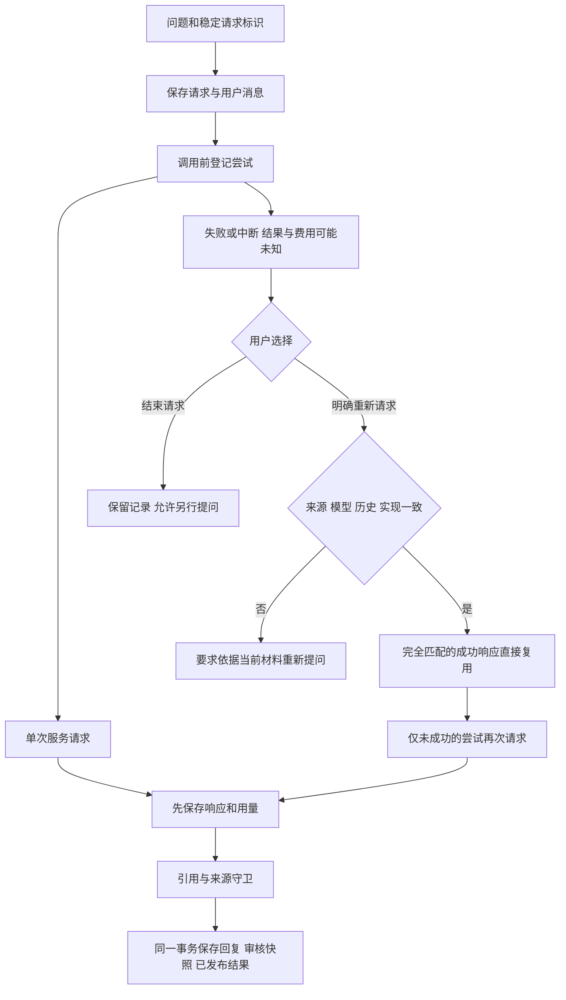

# N04 对话请求持久化与显式续验

更新：2026-10-23。实现范围为新的 Web 对话入口；不把旧消息反向补建为有完整调用记录的请求，不启动新的真实模型实验。

## 用户流程

新问题提交时生成稳定请求标识，先保存用户消息、当时范围和恢复绑定，再排队执行。界面的“本轮请求记录”可在刷新或重新打开会话后查看。相同标识只领取原记录，不能改成另一个问题；重复领取或查看结果不会调用模型。

已保存响应但尚未发布时，可“继续处理已存请求”；成功响应精确复用，不重复计入新调用。失败或只有发送登记的尝试必须明确选择“重新请求（可能再次计费）”。原失败、未知尝试和用量永久保留，不改写成新成功。

查看状态只投影“执行已中断”，不修改数据库。尚在执行时使用任务取消；没有执行者的未完成请求可以“结束此请求”，结束不证明服务没有计费，也不删除响应。取消发生在收到响应之后时，响应仍可保存供续验使用。

## 数据与恢复约束

schema **v14** 新增 `chat_runs` 和 `chat_run_calls`。前者保存请求标识、原问题/范围、用户消息、绑定哈希、运行状态和已发布结果；后者逐次保存逻辑阶段、精确请求哈希/内容、尝试序号、响应及独立思考、数值用量、安全参数和异常类别。它们在本机数据库中，不出现在状态接口正文或 Git；密钥、请求头、原始异常正文和服务 URL不写入调用诊断。独立思考只恢复作展示，不成为来源或下一轮事实。

调用前的登记是发送意图，不证明数据已到达服务；崩溃时按结果/费用未知处理。服务未上报用量不当作零费用。模型用量覆盖查询扩展和 QA；网页搜索另留阶段记录，不将网页服务次数算成模型 token。

恢复绑定包括当前范围、论文当前材料及可信状态/原文、人工知识快照及片段、此前历史和当前会话尾部、偏好、审核与压缩状态、模型/协议/参数、上下文/检索配置和实现哈希。新问题、材料换版、来源撤销或修改、模型切换、相关状态变化会阻止旧请求恢复。当前采用保守绑定，其他论文或审核变化也可能要求重新提问；不提供跨版本自动接续。

每次调用前和发布前重新核对绑定；请求级文件锁防止同一请求重复执行。持久路径关闭客户端隐式传输重试和 QA 超窗重发；不增加手工调用额度、输出额度或窗口配置。更换上游结果后若下游请求不再与已有记录一致，拒绝复用并要求新问题，不猜测缓存适用性。

回复、`qr_`人工审核快照和已发布结果在同一数据库事务提交；发布后的整理失败不把已发布记录降级为失败。结果重新读取时从原消息取回并重新检查来源/人工审核状态，不直接展示已失效的缓存答案。

## API

| API | 行为 |
|---|---|
| `POST /api/conversations/{cid}/chat-runs` | 创建或领取同一请求；字段 `request_id/question/top_k/web_search` |
| `GET /api/conversations/{cid}/chat-runs` | 最近30项；读取不调用模型 |
| `GET /api/chat-runs/{rid}` | 运行与各次安全状态、用量、是否需明确重试 |
| `GET /api/chat-runs/{rid}/result` | 已发布结果；读取当前消息与来源状态，不初始化模型/凭据 |
| `POST /api/chat-runs/{rid}/resume` | 未成功尝试须传 `retry_failed=true`；已发布请求不会重发 |
| `POST /api/chat-runs/{rid}/stop` | 结束没有执行者的未完成请求，保留调用历史 |

旧 `/api/chat/{cid}` 和通用 tasks 的旧 chat 操作保留兼容，不自动获得持久恢复；当前聊天界面已经使用新入口。旧单篇分析/对比/Skill/CLI/MCP的边界分别按各自契约判断。

## 备份与验证

v14表自动进入既有一致备份与新目录恢复，已验证请求、响应、结果及用量往返一致。备份仍要求 schema 匹配；v13归档不能用v14工具直接恢复。应使用匹配版本恢复至新目录，再由应用迁移；本轮没有操作用户日常库或旧归档。

改前 **1112项**通过；本次新增18条持久对话回归，完整 **1130项**通过，1个第三方弃用警告，无跳过。覆盖重复领取、失败显式重试、未知尝试保留、重启读取、已存响应复用、源/范围/历史/模型/偏好变化、取消后复用、发布后错误、畸形输入与备份。

无窗口验收使用本机真实API、临时库和离线模型，新增等待中刷新、原记录找回、失败记录重开、明确重试及旧尝试保留；原来源点击、人工审核/撤销、管理与备份流程保留。最终截图仅在 `_selftest.n04-chat-runs-ui-release-20261023/`。只读状态/结束请求的细化亦纳入最终完整回归与工作流确认。

没有新增付费请求；本轮证明持久化和交互边界，不证明模型语义质量改善。原24题与两题探针结果保持不变。后续冻结版本，执行完整固定验收及来源/版本反例；继续暂停F3/打包、D3和embedding。

2026-10-24 当前增量：schema已到v15，保留本契约的v14原始请求/调用表，新增知识依赖与本轮搜索证据授权。混合搜索响应精确复用、审核后重检索、传递失效及备份往返已离线验证。当前政策见[M04](M04对话侧缺口与设计-2026-10-21.md)，旧v14归档不能直接当作v15归档恢复。
