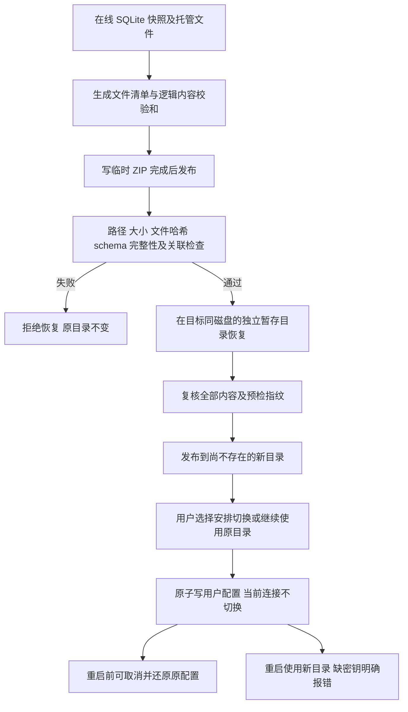

# N08 备份、恢复与目录迁移

初始实施2026-10-20，2026-10-24校对。当前源码已实现；提交及分支状态以 Git 为准，未重新打包。当前schema v15，额外保留知识依赖和本轮外部证据授权；初始实施为v12。本轮只操作隔离测试数据，未备份、迁移或打开用户实际知识库，未进行真实模型调用。

## 使用入口

在 **设置 → 备份与恢复**：

1. “下载备份”保存一致数据库快照、笔记、用户 Skill 和非密钥设置；可勾选托管目录中的原文文件。
2. 选择 ZIP 后先完整校验，展示论文、材料、原文块、审核、补录和托管原文数量。此时不恢复、不切换。
3. 填写父目录已存在、目标本身尚不存在的绝对路径，恢复至新目录。已有目录一律拒绝，原目录保留。
4. 若只想迁移当前资料，使用“复制当前资料到新目录”，包含托管原文，不删除来源目录。
5. 新目录完整校验后，选择“重启后使用恢复目录”。保存切换指向及备份中的非密钥设置；运行中的连接继续指向原目录。安排切换后暂停修改/生成，可在重启前取消；取消会还原原配置。
6. 重启后重新配置提供商密钥并选择模型。不会因密钥缺失静默切到 mock。

恢复目录也包含 `restored-config.yaml`，供 CLI 显式配置启动。目录切换修改的是用户配置中的 `app.data_dir`，不改变 `LITPRISM_HOME` 的配置查找根；若设置了覆盖数据路径的 `LITPRISM_DATA_DIR`，切换会明确拒绝，须先调整环境变量。

## 保存范围

| 对象 | 处理 |
|---|---|
| SQLite | 使用在线 backup API，包含 WAL 中已提交的记录，不直接复制正在使用的主 DB 文件 |
| 材料与引用 | papers/materials/chunks、FTS、当前材料 ID、历史分析、旧块 ID 与物理定位全部保留 |
| 审核与知识 | 语义审核/撤销、人工补录、来源快照及审核历史、真实性核验与白名单保留 |
| 研究数据 | 会话/消息/压缩/偏好、交付物、分组/回收状态、N01 运行与调用记录、候选池等数据库表保留 |
| 文件 | 配置的笔记目录、数据根的 skills 目录；papers 目录的托管原文按选项包含 |
| 配置 | 便携设置移除 API Key/SecretStore 引用等凭据字段，数据和笔记路径在恢复时重定位 |
| 密钥与临时状态 | 不包含 secrets.json、.secrets.key、缓存、预检上传、进程锁或实时任务队列 |

提供商数据库中的密钥**引用**保留用于说明缺失的配置，实际 SecretStore 不迁移。旧材料的 `origin` 或已保存的来源正文不会被重写。软件外部的原始文件不自动追踪/复制；不选原文文件时，数据库中的已解析原文和全部引用仍保留。

数据库按原样保存用户内容；凭据排除针对 SecretStore 与配置字段，不通过改写用户论文、对话或笔记来猜测删除内容。

## 校验与恢复流程



- `manifest.json` 记录每个归档文件的字节数/SHA-256，以及 schema、所有表的行数和逻辑校验和。保留审核依赖的 rowid 顺序。
- `content_hash` 是导出 → 恢复 → 再导出的比较口径。SQLite 文件字节可能因 WAL/页布局变化而改变，不能把这种变化当作用户数据不一致；单个 ZIP 内的物理文件校验仍严格执行。
- 预检不实例化 KnowledgeBase，不迁移当前库或恢复库；仅接受与当前运行版本相同的schema（当前v15）；v14/v13/v12旧归档须先用匹配版本恢复再迁移，版本不同明确拒绝。
- 验证数据库 integrity_check、foreign_key_check、必需表/字段与材料归属；拒绝不支持的视图、触发器及未知表。
- 拒绝 ZIP 路径穿越、绝对路径、目录链接、Windows 设备名、重复/大小写冲突路径、缺失/额外文件及校验和错误。
- 当前上限为 10,000 个有效载荷文件、20 GiB 解压内容；浏览器上传上限 2 GiB，大文件可用 CLI（仍受解压限制）。笔记目录不能包含整个数据根，也不能递归备份暂存自身。
- 恢复失败或中断清理暂存，不覆盖/删除原库；配置切换写入失败保留原配置。取消时若配置已被其他程序改变，会拒绝覆盖并要求人工核对。
- 有运行中/排队中任务或其他写请求时拒绝切换。切换待重启期间只开放 GET 读取及取消切换；不会让旧连接写入新库。
- CLI 激活应在退出应用后执行。切换不是删除迁移；成功恢复后旧目录继续保留。重启之后的回退需要退出应用并核对用户配置，不能依赖已结束进程中的取消状态。

## CLI

以下为使用说明，本轮未对用户实际目录执行这些命令；备份文件名和恢复目标应换成尚不存在的路径。

```powershell
$py = 'C:/Users/18434/.workbuddy/binaries/python/envs/default/Scripts/python.exe'
$env:PYTHONPATH = 'E:/codex-litprism/src'
$env:LITPRISM_HOME = 'E:/codex-litprism-data'

& $py -m litprism backup create --output 'E:/litprism-backup.zip' --include-originals
& $py -m litprism backup inspect 'E:/litprism-backup.zip'
& $py -m litprism backup restore 'E:/litprism-backup.zip' --target 'E:/litprism-restored'

# 替代手工导出再导入：复制当前资料和托管原文，原目录不动
& $py -m litprism backup migrate --target 'E:/litprism-migrated'

# 退出应用后，显式安排下次启动使用已恢复目录
& $py -m litprism backup activate --target 'E:/litprism-restored'
```

`backup inspect/restore` 不创建 CLI 的 Ctx、不打开当前用户库。`backup activate` 只读取用户配置与已校验的新目录，不迁移当前库。普通 `restore` 命令仍是原会话压缩块还原，未改变语义。

## API

| 入口 | 用途 |
|---|---|
| `GET /api/backups/status` | 当前目录、待重启切换目录及凭据说明 |
| `POST /api/backups/export` | `{include_originals: bool}`，下载 ZIP |
| `POST /api/backups/inspect` | multipart 的 file，完整预检后返回 token 与清单 |
| `POST /api/backups/restore` | `{token, target}`，校验预检版本并恢复到新目录 |
| `DELETE /api/backups/previews/{token}` | 丢弃上传预检文件；更换文件时 UI 自动清理旧预检 |
| `POST /api/backups/migrate` | `{target}`，复制当前数据及托管文件到新目录 |
| `POST /api/backups/activate` | `{target}`，忙碌检查、内容复验及安排重启切换 |
| `POST /api/backups/cancel-switch` | 重启前取消待切换并还原配置 |

预检 token 仅当前应用实例有效，1 小时过期，同时最多 3 份。数据目录不能通过普通 PATCH config 热切换。API 沿用 sidecar 的现有鉴权，本机所有测试使用临时 token。

## 验证

改前 **922** 项；新增 **31** 项 N08 专项测试，最终 **953 项通过**，保留 1 个第三方 Starlette/AnyIO 弃用警告。

专项覆盖：往返逻辑清单一致、WAL、历史材料/引用/审核/补录、偏好/产出/提供商引用、密钥排除、CLI 不触碰主库、损坏与不兼容备份、路径安全、现有目标拒绝、恢复中断、配置切换失败与取消冲突、忙碌任务、恢复后密钥缺失，以及笔记/暂存目录的递归防护。

`tools/check_workflows.py` 无窗口真实本地 API + 离线模型验收通过，覆盖备份下载、预检、错误目标恢复、成功恢复、切换后阻止写入与取消，以及现有研究/审核/撤销/材料历史工作流。浅色桌面和深色 850px 窄屏截图仅留 `_selftest.n08/`。

本轮不是用户主库恢复演练、跨机器 DPAPI 迁移或新安装包验收；这些不能据离线测试宣称完成。N07 策略 A/B 已于 2026-10-20 取消（分批只作自动兜底），下一项为整篇长论文验收，付费语义验收另行明确范围。
