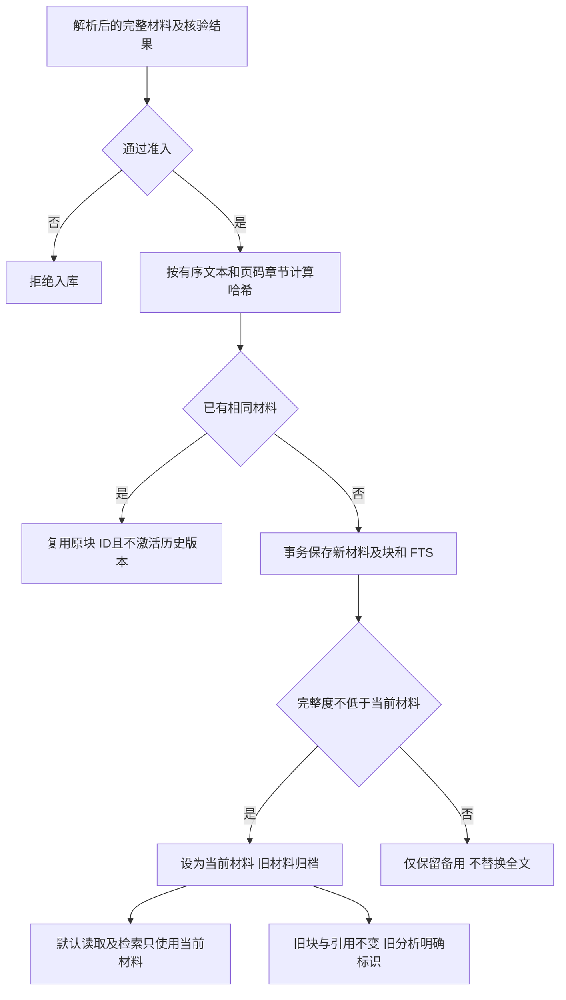

# N12 原文材料版本化与现状核对

2026-10-20。基点为主工作树提交 `30fd7a1`；在 `codex-work` 实施，提交及分支状态以 Git 为准。未打开用户主知识库、未调用真实模型或外部论文服务，未打包。

## 核对结果

- 改前全量 905 项通过。N05 人工补录与 N06 质量面板已接 API/UI，原状态页的 v10/866 项、缺少补录等描述滞后。
- N06 的 `manual / (machine + manual)` 是**已采集漏提占比**，不能作为真实召回。保留 `recall` 键兼容；界面和 CLI 均使用同源聚合，“只有人工补录、没有机器陈述”均为 n/a。
- N03 尚未闭环：`_candidates` 先在内存生成，最终保存才持久化；跳过机器复核后 report.items 为空，确认接口却只从该数组查陈述。因此不能说关闭模型后已支持候选直接确认。本轮登记，不将此称为完成。
- 原无窗口脚本曾填写已移除的阶段预算，不能沿用历史通过记录。本轮更新为实际调用次数、待审与精确恢复检查，并新增 N05/N06/N12 流程。
- arXiv 自动取全文原路径缺少显式真实性准入守卫；本轮补上，likely/unchecked/not_found 均不得保存论文或块。

## 材料快照契约

schema v12 新增 `materials` 与 `analysis_versions`；papers 保存 `current_material_id`，chunks/analyses 保存 `material_id`。

- `add_chunks()` 现在接收**一份完整材料**，不再隐式追加。需要补齐同一版材料时，调用方提交完整快照；不能将一个尾部片段误当整份新版原文。
- 默认 `policy=replace`：旧材料标记 superseded，不物理删除。`keep_both` 将旧材料标记 retained；两者的默认阅读范围都只有当前材料，历史材料可按 ID 查看。
- 哈希包括块顺序、文本、物理页与章节，不含随机块 ID。重复相同材料不重复写块；重试历史材料不将论文回退到旧版。相同内容的完整度可以升级，内容及原 ID 不变。
- 题录/摘要等低完整度材料留为备用，不替换当前全文；`papers.material_level` 继续只升不降。分析覆盖报告使用实际所读材料的完整度。
- 本地上传、CLI、学术题录、arXiv 导入均接入；题录更新和材料保存同处一个事务。空材料、ID 冲突等失败回滚，不留下半份当前材料。
- FTS 与 LIKE 默认只返回当前材料。旧引用仍通过保存的 chunk ID 精确回溯，superseded 不等于来源失效；文献回收、撤销或不再可信时仍拒绝引用。

## 分析与人工记录

- 新分析绑定所用材料；再次保存前将旧 payload/model/时间/材料归档到 analysis_versions。旧 payload 与审核哈希不重写，人工审核与补录记录保留。
- 新导入后，旧分析仍可看，但不当作当前材料的缓存结果。解读期间原文变化会拒绝发布，N01 标记 stale；旧成功请求不能套用新材料。
- 旧分析不能作为当前笔记导出或自动填入当前 GenUI/Skill 分析。历史来源本身仍可查看和核对。旧产出继续按自身来源快照和可信状态验证，不自动改写。
- 补录来源必须属于该分析所绑定的材料，不能把新原文的遗漏统计混入旧分析。历史分析为只读展示，历史审核/补录可通过对应 version_id 读取；新审核仍要求最新分析哈希。
- 界面提供材料与分析记录选择器；旧分析显示提示，原文默认仅当前材料，切换历史材料不触发模型调用。

## API

| 入口 | 行为 |
|---|---|
| `GET /api/paper/{pid}/materials` | 材料清单、当前 ID、历史分析摘要 |
| `GET /api/paper/{pid}/text?material_id=...` | 指定材料的原文；省略为当前；跨论文 ID 拒绝 |
| `GET /api/paper/{pid}?version_id=...` | 指定历史分析；默认最新；返回 analysis_material 的 ID/current 状态 |
| `GET /api/paper/{pid}/semantic?version_id=...` | 对应历史分析的原文、审核与补录记录，只读 |
| 上传及候选 fetch/import 的 `material_policy` 查询参数 | replace（默认）或 keep_both；UI 日常导入继续用默认策略 |

## 迁移与剩余边界

v12 在显式事务中建表、加列和回填；失败整体回滚。旧原文块 ID、rowid、页码、文本、FTS 与分析 payload 保持原样。旧数据全部已有块保守归为一份 legacy 快照，不能从混合历史中凭空还原原来的多个文件版本；没有可验证引用的旧分析保持未绑定，并提示重新解读。

目前版本化的是**已解析文本材料**，不是所有原始 PDF 附件的不可变存储。arXiv 下载文件仍有原缓存路径；全库备份恢复与可选托管附件清单现已由 [N08](N08备份恢复与目录迁移-2026-10-20.md) 实现，不扩展为原始附件的不可变版本存储。非 arXiv 全文由用户上传；普通网页正文自动抓取仍未实现。

## 验证

- N12 当时改前 905，改后 **922 项通过**，保留 1 个 Starlette/AnyIO 第三方弃用警告。
- 新增材料替换/保留、内容幂等、完整度、历史引用/审核/补录、归档、跨论文拒绝、旧分析缓存/导出、并发读取、旧库迁移/回滚和 CLI 指标一致性测试；修正原尾部阅读测试为提交完整材料，继续验证全文尾部覆盖。
- `tools/check_workflows.py`：隔离临时库、真实本机 API、离线模型、无窗口 Chromium；覆盖持久恢复、来源链接、审核/撤销、人工补录、质量面板、材料/分析切换、历史来源右栏、浅深主题及 850px 窄屏。
- 截图和日志仅存本地 `_selftest.n12/`；不构成真实学术语义或安装包验收。

后续进展：N08 已通过隔离数据与无窗口验收；下一项按 [实施计划](实现计划.md) 推进 N07。N03 未完成部分与 N02 真实整篇质量仍需分别收口。
