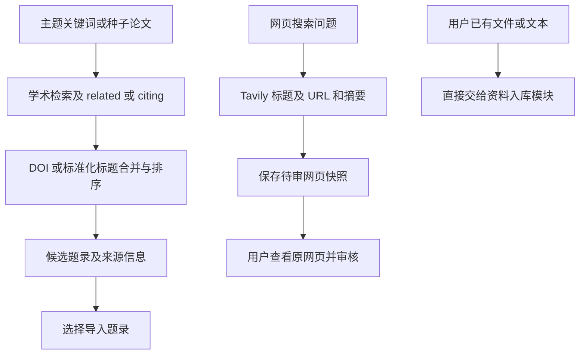

# M01 来源发现与候选

更新：2026-10-19。本页说明模块边界；“当前实现”与“修订目标/缺口”分开，后续实施顺序只维护在 [实现计划](../实现计划.md)。本轮只整理文档。

## 当前入口与来源清单

| 来源/入口 | 代码中的实际用途 | 当前边界 |
|---|---|---|
| 用户本地文件 | PDF/DOCX/HTML/TXT/MD/TeX 导入 | 来源由用户提供，仍需解析和文献真实性核验 |
| OpenAlex | 学术关键词检索、related/citing、题录与真实性核验 | 主要得到题录、摘要和链接，不自动取得全部正文 |
| Crossref | 题录/DOI/标题检索与核验 | 不是全文抓取器 |
| arXiv | 学术检索与题录核验 | 当前没有从检索结果自动下载并导入 PDF 的完整编排 |
| Semantic Scholar | 可选核验；显式选择时有搜索分支 | 默认配置关闭；默认外部搜索列表不自动包含它 |
| Tavily | 普通网页搜索，保存标题、URL、搜索摘要候选 | `include_raw_content=False`，并未获取原网页正文；需要密钥和配置 |
| 用户粘贴网页/知识文本 | 创建来源快照 | 文本先待审；填写 URL 不会触发下载或自动真实性认证 |
| Unpaywall | 仅有配置字段与旧设计设想 | 当前源码未接通获取 OA PDF 的工作流，不能算一个已工作的全文来源 |
| SearXNG | 配置数据类中出现名称与地址 | 当前 `discover_web()` 只实现 Tavily；不能算第二个已接通网页搜索后端 |

这是源码能力与默认配置清单，不是对本机服务已配置、联网可用或检索效果的实测结论。本轮不读取用户服务凭据，不联网查询。

默认学术搜索遍历启用的 OpenAlex/Crossref/arXiv，按 DOI 或标准化标题合并结果并排序。数据库返回记录可带 `verified` 存在性背书；多源再核验是另一个可选步骤，不能说每条候选默认都经过了独立多源复核。

## 当前发现流程

学术发现与网页搜索当前是两条路径，还没有统一的候选池、分类、筛选记录及到全文获取的连续状态机。

## 应补齐的前置步骤（目标，不是已上线）

1. 明确研究问题、检索词、范围和种子文献；不强迫用户先写复杂检索式。
2. 汇集不同入口，保留原查询、来源、URL、时间和原始候选内容。
3. 区分论文题录、论文网页/PDF、普通网页和用户知识；不把搜索摘要当正文。
4. 在已有记录去重基础上明确 DOI/arXiv 版本、URL、内容指纹及已有材料关系，避免重复或混版。
5. 供用户筛选与确认；候选未选中或无法判定时可以暂存，不直接污染可引用内容。
6. 根据类型移交 M02：论文走题录身份核验与全文获取，普通网页走正文/快照获取与人工审核。

“数据来源不多”既包括搜索后端较少，也包括目前多为元数据/摘要，真正取得完整材料的渠道未形成闭环。先补好候选到可追溯内容的接线，再扩展来源；只增加搜索 API 数量不能补上正文获取和版本缺口。本页不新增第三方服务选型。

依据：[`search.py`](../../src/litprism/search.py)、[`verify.py`](../../src/litprism/verify.py)、[`config.py`](../../src/litprism/config.py)、[`web/evidence_routes.py`](../../src/litprism/web/evidence_routes.py)、[`agents.py`](../../src/litprism/agents.py)。
