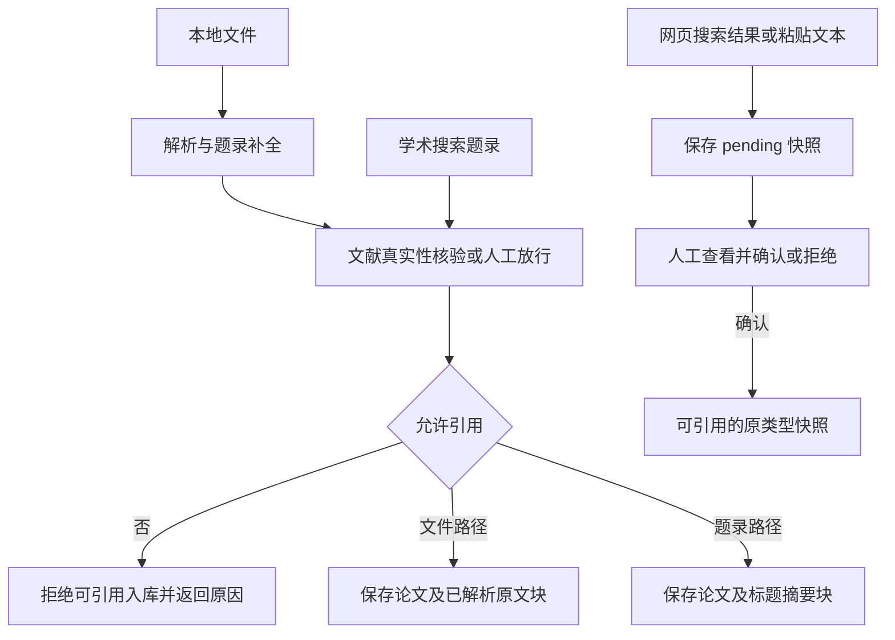
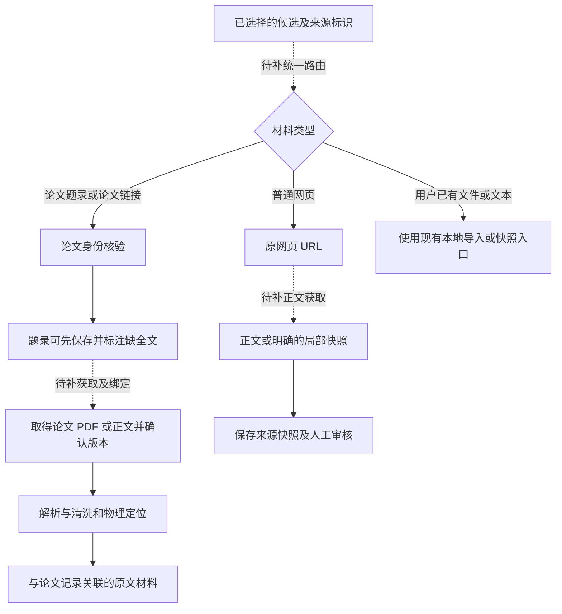

# M02 论文与网页资料入库

更新：2026-10-19。本页说明模块边界；“当前实现”与“修订目标/缺口”分开，后续实施顺序只维护在 [实现计划](../实现计划.md)。本轮只整理文档。

## 现有三条路径

| 路径 | 当前处理 | 能得到什么 | 尚未接通什么 |
|---|---|---|---|
| 本地文件 | 解析、题录补全、文献真实性核验/人工放行、保存原文块和 FTS5 | 有物理页定位的已解析材料；具体格式能力不同 | 扫描件可靠转写、复杂版式专项保障 |
| 学术搜索/推荐结果 | 核验可引用性，`import_record()` 保存题录并写“题录与摘要”块；**arXiv 候选可通过 `POST /api/candidates/{id}/fetch` 自动取 PDF 并升为全文** | 题录/摘要，或（arXiv）带物理页的全文 | 非 arXiv 来源的自动取全文、材料版本与附件绑定 |
| 普通网页搜索或手工文本 | 创建 `kind=web/knowledge`、`status=pending` 的内容快照；人工确认后可引用 | 搜索摘要或用户提供的文本，来源类型保留 | 自动抓取网页正文、解析清洗、识别论文链接后转入论文入库流程 |

## 当前流程

人工确认文献真实性、人工确认网页快照、人工确认知识陈述分别记录，不是同一个动作。`verified/manual_confirmed` 只说明对应核验/审核状态，不能据此推导已取得全文。

## 缺少的内容获取接线

下面虚线是目标；用户仍可先保存题录，稍后补全文，而不是强制所有题录都先下载成功。

前置应保留：来源 URL/数据库标识、抓取/导入时间、文本范围、内容哈希、论文版本、处理失败原因和材料完整度。搜索摘要、摘要、局部正文、全文应明确区分，不能用一个“已入库”标签掩盖差异。

材料完整度已落库（`papers.material_level`，schema v9）：题录导入=abstract/metadata，本地导入=fulltext，重复导入只升不降；解读与界面据此标注"仅题录/摘要"。

当前 `find_duplicate()` 已有 DOI 和标题/年份指纹去重，但没有完整的跨来源材料版本合并工作流。`add_chunks()` 是追加原文块，重复导入的材料关联与版本清理仍需专门设计，不能把“返回已有 paper_id”当作全文附件已安全合并。

**当前风险边界**：P 系列的 `whole` 表示全部“已索引块”进入请求；若某论文仅有摘要块，不能把它称作整篇论文已读完。材料完整度提示与进入全文解读前的产品级识别仍需补齐，本轮不宣称代码已经阻止了所有这类误用。

依据：[`db.py`](../../src/litprism/db.py)、[`search.py:import_record`](../../src/litprism/search.py)、[`web/server.py:upload`](../../src/litprism/web/server.py)、[`knowledge.py`](../../src/litprism/knowledge.py)、[`ingest.py`](../../src/litprism/ingest.py)。联网获取原设计保留在 [W1–W3 历史目标](../design/联网检索与知识库扩充设计.md)，不作为已完成声明。
