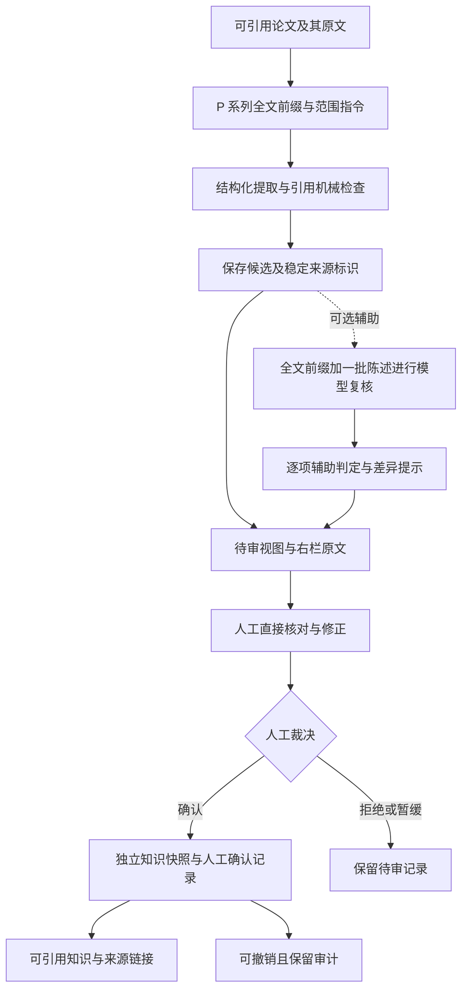
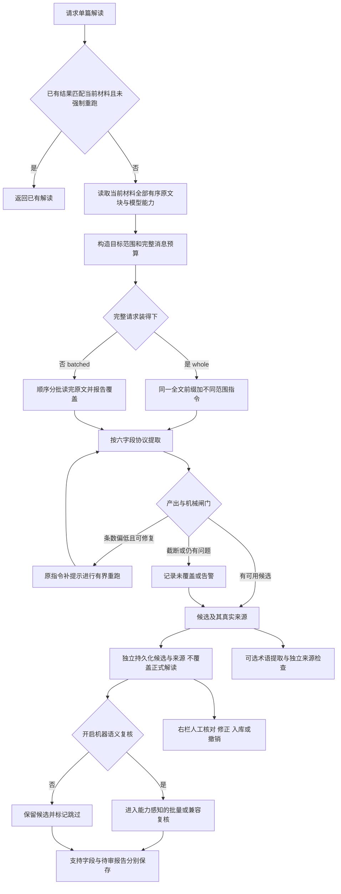
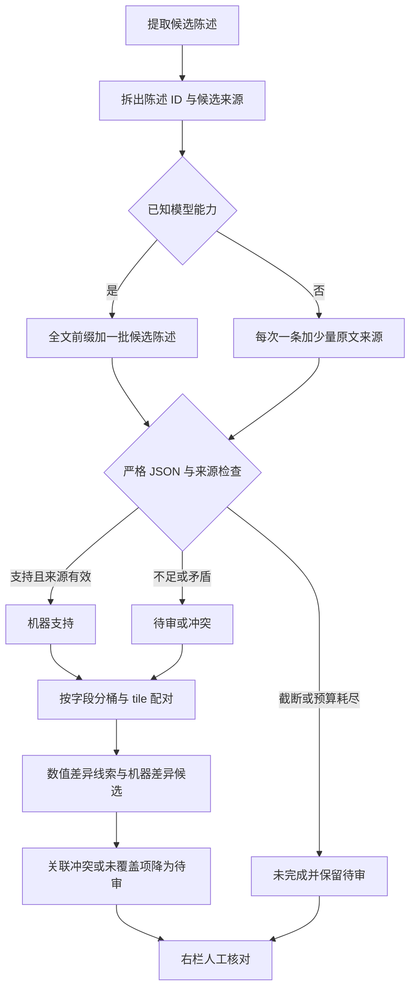

# M03 阅读提取与协作审核

更新：2026-10-22。本页说明模块边界；后续实施顺序只维护在 [实现计划](../实现计划.md)。

前提是明确材料范围与完整度，见 [M02](02-论文与网页资料入库.md)。`whole` 不自动等于已取得论文全文。

## 当前协作流程（已实现）

产品是研究辅助工具。真实性核验、原文定位和引用回溯是共同基础；不应将“先完成所有模型语义复核”变成人工开始阅读、修正和裁决的前提。

- 原文能装下时，提取继续采用 P 系列全文前缀与范围指令。
- 模型语义复核作为**可选辅助**（已实现）：`semantic_review` 开关可关闭，关闭时 `skipped_by_user`；
  开启时复用全文序列化内容、一次核对多条候选陈述，批量按内容组织。
- 全部提取完成后、机器复核前，候选持久化到独立 `ac_` 快照，不覆盖旧正式分析；后台复核失败或跳过仍可读取和人工审核。尚未实现逐条提取指令完成即保存。
- 人工可以直接在右栏查看原文、修正、确认、拒绝或撤销，无须先获得模型支持；审核接口联合候选与机器报告查找陈述，并重新核验真实来源。
- 提取候选、机器支持和人工确认分别标识。候选可在明确标注的待审视图阅读，不能冒充正常已核验结论；进入可信知识库仍需显式人工确认并保留来源。人工确认也不等于客观真实性保证。
- 文献真实性核验、来源白名单/页码、版本绑定、撤销与导出重验继续强制执行。机器可选不意味着取消这些守卫。

**当前协作流程（提取完成后保存候选）：**

候选在复核前独立保存、跳过机器复核后直接确认、失败后保留人工路径均已通过隔离 API 与无窗口验收。提取期间尚无完整候选快照；机器支持、人工确认和覆盖范围仍是三个口径。

“全文前缀”指每次请求重新发送同样的全文原文，不依赖服务端永久保存论文。复核阶段内应固定系统提示，批次陈述放在尾部；不同阶段系统提示不同，不能承诺提取与复核一定共享远端缓存。

## P 系列提取：当前流程

代码会限制修复轮数；图中回路不是无限重试。当前截断不会自动对半拆新指令；无可用结果时该单元未覆盖，普通异常可能终止运行。告警候选可继续核查，但未覆盖标记不会因此自动消失。

P 系列按真实 chunk/字符区间限定提取范围；全文仍按原文顺序提供，不是重新按章节重要性截取正文。`quota_for()` 仍是内部经验估算，不是人工设置的输出上限或事实覆盖证明；不固定 `quota=44`。

缓存只是潜在收益：本地 `Plan.cache_key` 是规划标识，不是服务端缓存键，也不能证明命中。命中、未知用量以服务返回字段为准。

依据：`plan.py:build_plan()`、`extract.py:analyze_paper()` / `_run_with_repair()`、`gates.py`、`usage.py`。

## 机器复核与验证边界

复核层已接模型能力：能力已知时按窗口批量核对并复用提取阶段的全文前缀（240 条合成数据：240 次调用降到 1 次）；能力未知的旧入口仍保留约 6000 token、每次一条。差异层同轮接线：tile 按半个窗口装、差异条数不限 4 对、调用上限在能力模式下取消；
240 条单字段合成数据可按窗口合并到一个 tile；实际调用数取决于陈述长度及可用窗口。该回归只证明批量协议与范围覆盖，不证明真实论文质量；能力未知入口的小来源约束也不是产品必选设计。

差异检查在同字段桶内进行 tile 配对，包含同批和跨批；跨字段没有完整两两检查。机械数值线索不是独立证明，更不是已把实验工具的全部数值签名接入生产。存在未完成或待审时不能称整体通过。

协作流程见第一节。批量复核和独立人工路径已接通；复杂来源的语义准确性与跨字段一致性仍须另行验收。

知识条目如何确认入库与撤销，见 [M05](05-知识沉淀与产出.md)；运行暂停与恢复见 [M06](06-模型运行与数据管理.md)。

## 候选与材料版本边界

`_candidates` 在全部提取完成后写入 `analysis_versions` 的独立 `ac_` 快照，保存模型、运行 ID、原文引用与父分析哈希。活动候选仅显示当前材料且父分析未变化的最新分支；最终正式分析引用 `_candidate_snapshot_id` 后不重复显示候选分支。人工审核记录绑定具体分析哈希，不自动转移到机器随后发布的正式分析；已确认知识及来源审计仍保留，可在知识来源页撤销。备份保留这些快照，普通历史分析列表不混入候选。N03 协作闭环已实现，复杂来源质量仍未整体验收。N12 见 [实施契约](../N12原文材料版本化-2026-10-20.md)。
