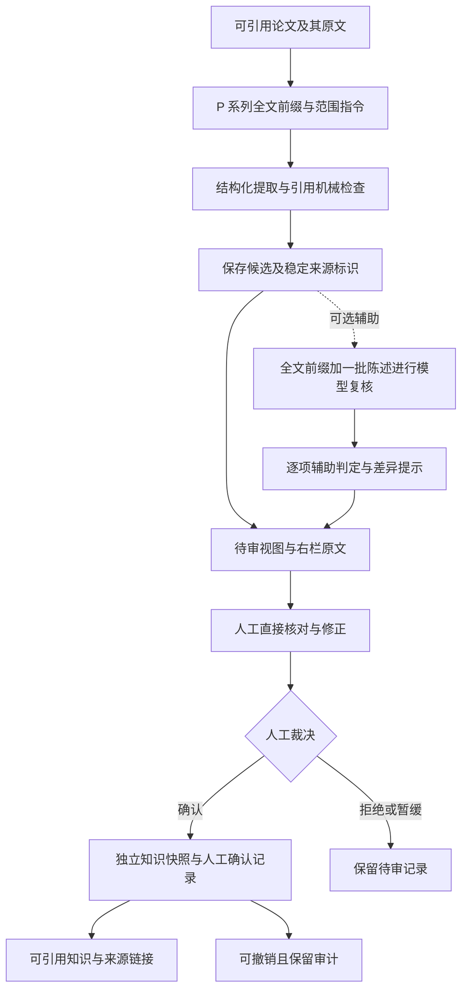
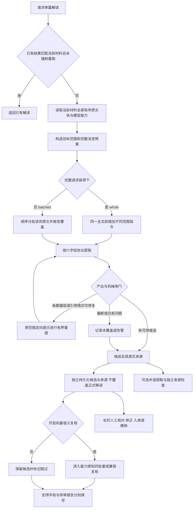
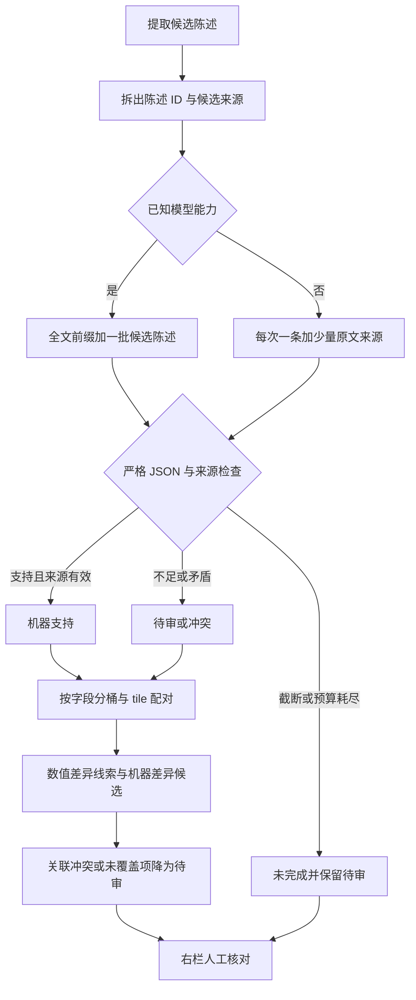

# M03 阅读提取与协作审核

更新：2026-11-16。本页说明模块边界；后续实施顺序只维护在 [实现计划](../实现计划.md)。

前提是明确材料范围与完整度，见 [M02](02-论文与网页资料入库.md)。`whole` 不自动等于已取得论文全文。

[短论文历史验收](../N01短论文六字段验收-2026-10-29.md)与原始结果保留：数值范围/直接来源及计数提示已修，原加速引用P16须邻接P17补全。旧阅读M2预测机制部分和计数flag不作为继续研究的障碍；2026-11-16已通过[真实追问与选择性知识沉淀](../渐进研究闭环架构对照与验收-2026-11-16.md)补出预测机制，由受用户委托的代理按原文语义确认其中一条并实际重新检索引用，不回写旧N01结果或要求审核整篇。

## 当前协作流程（已实现）

产品是研究辅助工具。真实性核验、原文定位和引用回溯是共同基础；不应将“先完成所有模型语义复核”变成人工开始阅读、修正和裁决的前提。

- 原文能装下时，提取继续采用 P 系列全文前缀与范围指令。
- 模型语义复核作为**可选辅助**（已实现）：`semantic_review` 开关可关闭，关闭时 `skipped_by_user`；
  开启时复用全文序列化内容、一次核对多条候选陈述，批量按内容组织。
- 全部提取完成后、机器复核前，候选持久化到独立 `ac_` 快照，不覆盖旧正式分析；后台复核失败或跳过仍可读取和人工审核。尚未实现逐条提取指令完成即保存。
- 人工可以直接在右栏查看原文、修正、确认、拒绝或撤销，无须先获得模型支持；审核接口联合候选与机器报告查找陈述，并重新核验真实来源。
- 提取候选、机器支持和人工确认分别标识。候选可在明确标注的待审视图阅读，不能冒充正常已核验结论；进入可信知识库仍需显式人工确认并保留来源。人工确认也不等于客观真实性保证。
- 文献真实性核验、来源白名单/页码、版本绑定、撤销与导出重验继续强制执行。机器可选不意味着取消这些守卫。

**当前协作流程（提取完成后保存候选）：**

候选在复核前独立保存、跳过机器复核后直接确认、失败后保留人工路径均已通过隔离 API 与无窗口验收。提取期间尚无完整候选快照；机器支持、人工确认和覆盖范围仍是三个口径。

“全文前缀”指每次请求重新发送同样的全文原文，不依赖服务端永久保存论文。复核阶段内应固定系统提示，批次陈述放在尾部；不同阶段系统提示不同，不能承诺提取与复核一定共享远端缓存。

## P 系列提取：当前流程

Web论文详情已统一为“解读论文/重新解读”，默认走N01持久运行，明确新建时重读当前材料；恢复复用精确成功响应。下面的缓存节点描述内核兼容调用，不能将命中旧分析缓存当作完成一个新建的Web运行。材料范围预检、失败/未知重试与当前记录见[M06](06-模型运行与数据管理.md)。

代码会限制修复轮数；条数偏低、已校验字段引用但正文缺行内引用以及已有结构重试共用原循环，最多初次加2轮，不为每类错误重置次数。缺引用采用专门提示重新返回完整六字段，不误称条数不足，不在本地给每条陈述铺上字段来源。重提后仍校验来源/物理页/格式，失败保留flagged与候选；原始N01请求/响应由持久调用记录保留，coverage.repair_attempts保存失败闸门和是否继续的摘要。范围预检预留两类提示的组合体积，每次实际发送前仍验完整窗口。普通传输错误/未知不按格式自动重试。

图中回路不是无限重试。兼容的无指令分批入口仍不新增这种重提；当前截断不会自动对半拆新指令，无可用结果时该单元未覆盖。告警候选可继续核查，但未覆盖标记不会因此自动消失。

P 系列按真实 chunk/字符区间限定提取范围；章节标签只作导航，目标区间中包含的子标题不能因标签不同而排除。全文仍按原文顺序提供，不是重新按章节重要性截取正文。`quota_for()` 仍是内部经验估算，不是人工设置的输出上限或事实覆盖证明；不固定 `quota=44`。

PDF书签先定位物理页，再用该页的完整标题行（可跨短行）确定章节边界；同页多个标题分别保留，跨页续文属于实际前一节。缺失、重复或顺序冲突时不猜位置，合并保留书签名、显式标为“页级范围；章节边界未定位”并给出解析告警。未定位的参考文献范围仍排除出可引用块。该修复只影响新解析：旧材料、块ID和历史分析不会自动重写；需要重新导入生成新材料版本后才获得新章节划分，仅点击重新解读不会重新解析原PDF。

六字段提取提示明确区分背景常见做法、相关工作、对比基线和本文实际方案；背景中举例的可选技术不能改写为本文采用的实现。采用既有技术不能据此升级为首次原创。作者的可能解释、尚不明确和未来计划应保留原来的确定性与时态，原文明示的结果也不一律降为猜测。这是生成契约，不是本地语义裁判；本地合并/候选保存不替换原句、修补主张或自动确认知识，机械引用通过仍不证明归属或因果正确。

创新点仍用原JSON字符串字段，每条贡献改为独立完整句、换行分隔并就地引用；未来计划明确写作者计划/将做，也可省略。引用存在性按与候选相同的句界核对，不能由一条带引用的句子掩盖同字段另一条无引用的句子；句末标点之后紧跟的引用仍归该句。它只检查引用是否出现，不证明语义支持或复杂分句的全部细节覆盖。

术语提取在同一全文前缀下只尝试一次，实际分批按各自原文分别执行。术语定义与用法需引用及可定位引句；通用含义无论文链接，缺证保留待核对。术语引用回到分析版本的原文，当前请求内的同篇同版相邻块可补充术语用法或恢复有重叠的跨块引句，补充来源单独标注；只规范可定位的连字符排版，完整术语关联仍不足的用法继续待核对。旧单段释义不回写；详见[术语入口验收](../N04术语入口验收-2026-11-18.md)。

数值生成还需保留对象、任务/数据、训练或测试阶段、单位及量词范围，不把实验中可达到的值变为普遍下限或最坏情况保证，不把每项/合计/均值或上下界互换。句内事实必须由实际所引原文块直接承载；多个事实宜拆开分别给依据，表格引用需要对应的行列/指标/设置，必要时同时引用连续表头和数据。全文其他位置有该事实不等于当前引用正确。上述是通用生成要求，不按本轮论文术语硬编码答案。

既有候选绑定仍优先使用句内引用，有句内引用时不回灌该字段全部来源；只对切断处有限补充同论文邻接块并保留标识。原响应回放不自动换源或修正量词，程序中的编号/物理页校验不等于归属或蕴含。计数仍用兼容的section_coverage名和原估计/flag/修复策略：偏高只说明高于数量估计，不推定重复或编造；落在区间也不证明完整或正确。不放宽阈值、不自动放行知识。

缓存只是潜在收益：本地 `Plan.cache_key` 是规划标识，不是服务端缓存键，也不能证明命中。命中、未知用量以服务返回字段为准。

依据：`plan.py:build_plan()`、`extract.py:analyze_paper()` / `_run_with_repair()`、`gates.py`、`usage.py`。

## 机器复核与验证边界

复核层已接模型能力：能力已知时按窗口批量核对并复用提取阶段的全文前缀（240 条合成数据：240 次调用降到 1 次）；能力未知的旧入口仍保留约 6000 token、每次一条。差异层同轮接线：tile 按半个窗口装、差异条数不限 4 对、调用上限在能力模式下取消；
240 条单字段合成数据可按窗口合并到一个 tile；实际调用数取决于陈述长度及可用窗口。该回归只证明批量协议与范围覆盖，不证明真实论文质量；能力未知入口的小来源约束也不是产品必选设计。

差异检查在同字段桶内进行 tile 配对，包含同批和跨批；跨字段没有完整两两检查。机械数值线索不是独立证明，更不是已把实验工具的全部数值签名接入生产。存在未完成或待审时不能称整体通过。

协作流程见第一节。批量复核和独立人工路径已接通；复杂来源的语义准确性与跨字段一致性仍须另行验收。

知识条目如何确认入库与撤销，见 [M05](05-知识沉淀与产出.md)；运行暂停与恢复见 [M06](06-模型运行与数据管理.md)。

## 候选与材料版本边界

`_candidates` 在全部提取完成后写入 `analysis_versions` 的独立 `ac_` 快照，保存模型、运行 ID、原文引用与父分析哈希。活动候选仅显示当前材料且父分析未变化的最新分支；最终正式分析引用 `_candidate_snapshot_id` 后不重复显示候选分支。人工审核记录绑定具体分析哈希，不自动转移到机器随后发布的正式分析；已确认知识及来源审计仍保留，可在知识来源页撤销。备份保留这些快照，普通历史分析列表不混入候选。N03 协作闭环已实现，复杂来源质量仍未整体验收。N12 见 [实施契约](../N12原文材料版本化-2026-10-20.md)。
