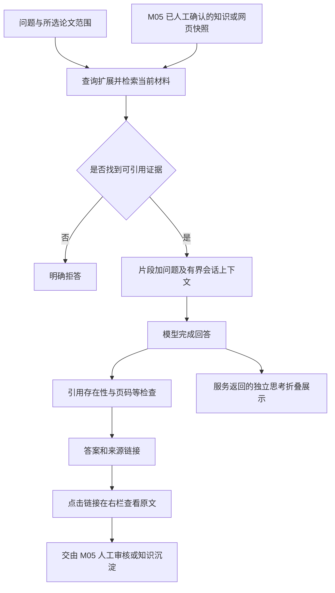
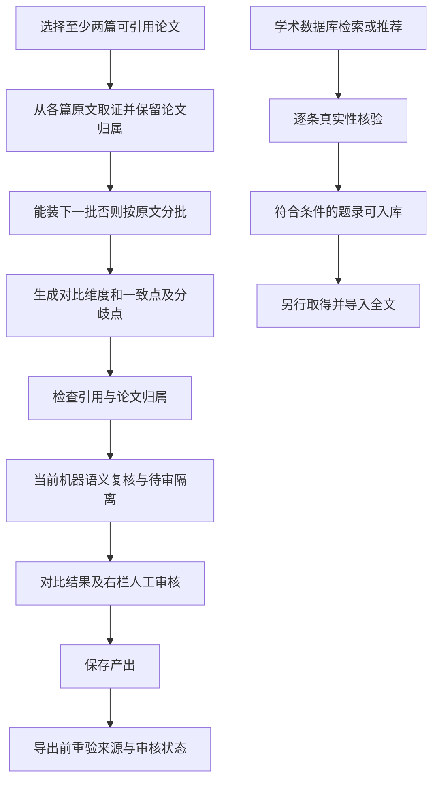

# M04 检索问答与研究

更新：2026-10-20。本页说明模块边界；“当前实现”与“修订目标/缺口”分开，后续实施顺序只维护在 [实现计划](../实现计划.md)。

## 聊天与来源交互：当前流程

网页搜索摘要先作为待审候选，不直接作事实输入。思考文本不作为证据或下一轮事实输入；目前在完成后展示，不是流式推送。普通 QA 没有获得与六字段解读相同的逐条语义保证。

针对机器陈述的确认会生成独立知识快照，保留原分析版本、陈述与来源；不会把原机器判定改写成“它本来就正确”。来源拒绝、撤销或回收后，历史链接应显示失效，导出也必须重验。

依据：`agents.py:QAAgent`、`web/server.py:chat()`、`web/evidence_routes.py`、`web/semantic_routes.py`、`knowledge.py`。

## 跨论文研究：当前流程

问答和对比默认读取当前材料，历史块只按原引用 ID 回溯；对比不复用旧解读作为事实证据。旧分析不能自动作为新材料的结论。题录入库不等于已下载全文；arXiv 可自动取全文，其他来源由用户上传；普通网页正文获取仍未接通。分组、标签、TF-IDF/术语关联用于管理与发现线索，不等同于真实引用网络。

Skill 是声明式扩展，调用内核检索/上下文与产出守卫，不能执行任意代码或取消引用检查；不因 P 系列实现就自动获得六字段同等语义保证。产出预览、单项/批量导出均须保留来源状态边界。

依据：`agents.py:CompareAgent` / `RecommendAgent`、`comparison.py`、`deliverables.py`、`skills/runner.py`、`web/workflows.py`。

来源发现、推荐结果的材料取得边界统一见 [M01](01-来源发现与候选.md) / [M02](02-论文与网页资料入库.md)，可信知识与导出见 [M05](05-知识沉淀与产出.md)。题录摘要也可成为召回证据；此时结论只能限于该摘要提供的信息，不能冒称已依据全文。

## 对话侧缺口（2026-10-21）

范围、引用、来源回看与来源入库**均已接通**：新建对话可选范围（`web/workflows.js` 的 `showConversationDialog`），
回答底部来源链接打开右栏（`app.js` → `workflows.js:loadEvidenceDetail`），网页/知识条目在右栏人工审核后入知识库。
**回答本身不作为知识入库对象** —— 那是模型生成物。

仍缺三项，顺序与验收见 [M04 对话侧缺口与设计](../M04对话侧缺口与设计-2026-10-21.md)：
~~范围**可设不可见、不可改**~~（**2026-10-21 已实现**：`PATCH /api/conversations/{cid}` 支持 `scope`，
对话页显示范围胶囊，论文页有「就这篇提问」）；对话侧无验收与指标（N04 未执行，仅 1 个测试文件 5 个用例）；
指代消解是正则拼接（`context/dialogue.py`）、检索为单次 BM25 无 rerank。

