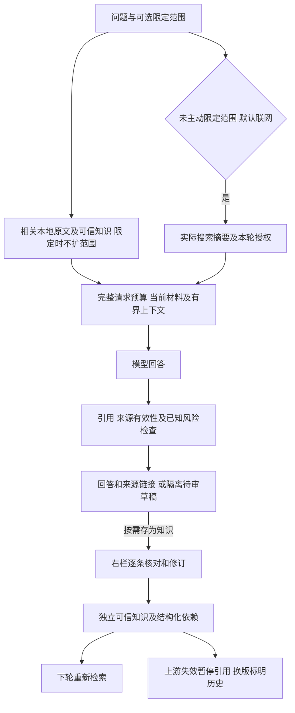
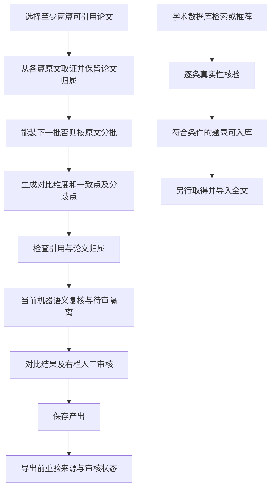
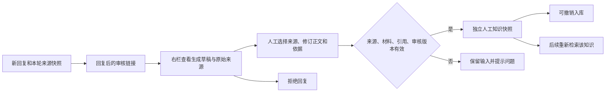

# M04 检索问答与研究

更新：2026-10-24。本页说明模块边界；后续实施顺序只维护在 [实现计划](../实现计划.md)。

## 聊天与来源交互：当前流程

当前Web界面默认综合全库相关论文、人工确认知识与本轮实际搜索摘要，来源和审核状态分别标识。仅保留回答范围选择；主动指定论文/分组时只使用该范围，不额外联网。“仅依据”等明确来源指令同样限制；“只用左侧上下文”等内容描述不算来源限制。未选论文/空列表表示不限定，检索相关项而非全库全文全部送达。非法/已删除选择报错，已选空分组保留过滤。旧重点/严格API字段与既有会话、显式离线请求继续兼容，不批量改写。

论文完整当前材料装得下时仍优先送达，否则按片段/章节/概览取证。历史和思考都不作本轮事实依据；思考完成后折叠展示，尚非流式。临时网页证据不自动获全库准入；候选列表有 URL 不等于已经取得网页正文。

辅助对应记录格式/缺项只提示，明确排版等价保留原文和位置；虚构编号、错页、来源失效及已知证据风险仍阻止相关结论。尚无可靠影响边界时保守隔离整答，不自动删句拼成修复答案。原句定位和 answered 不代表语义通过。

模型输入用带编号的正文起止边界区分各块，要求先复制该编号内的原句再写回答；相邻块分别引用，直接引句不得同义改写。边界计入输入预算，不改变原文、来源右栏或定位阈值。五份真实旧稿已零调用回放，两个旧错误仍拦截；新生成遵循情况未复测，不据此回写旧结果。

人工裁决后原回复和相关摘要退出后续上下文，修订知识重新检索；来源回收/撤销或传递依赖失效会影响其可用性，审核历史保留。完整接口、版本及边界见[M04当前契约](../M04对话侧缺口与设计-2026-10-21.md)。

追问现从有效历史及压缩覆盖消息的实际引用恢复当前论文/知识句柄，不重放原回答；材料换版、来源撤回或裁决失效时连同旧摘要排除。摘要仅解释指代和意图，内部检查点不显示成聊天消息，原问答和审计保留。恢复知识先计入材料预算，严格论文范围与旧网页授权不跨轮的边界保持。这是程序确定性恢复，尚非模型自主选择恢复工具。

## 跨论文研究：当前流程

问答和对比默认读取当前材料，历史块只按原引用 ID 回溯；对比不复用旧解读作为事实证据。旧分析不能自动作为新材料的结论。题录入库不等于已下载全文；arXiv 可自动取全文，其他来源由用户上传；普通网页正文获取仍未接通。分组、标签、TF-IDF/术语关联用于管理与发现线索，不等同于真实引用网络。

Skill 是声明式扩展，调用内核检索/上下文与产出守卫，不能执行任意代码或取消引用检查；不因 P 系列实现就自动获得六字段同等语义保证。产出预览、单项/批量导出均须保留来源状态边界。

依据：`agents.py:CompareAgent` / `RecommendAgent`、`comparison.py`、`deliverables.py`、`skills/runner.py`、`web/workflows.py`。

来源发现、推荐结果的材料取得边界统一见 [M01](01-来源发现与候选.md) / [M02](02-论文与网页资料入库.md)，可信知识与导出见 [M05](05-知识沉淀与产出.md)。每轮保留范围快照、送达范围、状态及用量；概览和章节仍可能因窗口裁减，界面明确提示。复杂指代没有完成语义改写，当前优先用历史实际引用定位论文身份。

题录摘要也可成为召回证据；此时结论只能限于该摘要提供的信息，不能冒称已依据全文。

## 对话侧当前进展与剩余缺口

范围可见可改、N04 验收 v3、实际来源计分、真实多轮保存、错误引用隔离及按问题组织材料已接通。拒答的已校验解释性引用也保存并可在右栏回看，状态仍是拒答，不作为后续事实。旧桩报告不构成质量基线；[四篇与 24 题真实验收](../N04真实对话验收-2026-10-21.md) 已完成但未通过，暴露归属/否定错误、追问和方法/多篇概览漏召回及章节边界问题。随后[真实多轮受控压缩](../N04多轮追问与受控压缩验收-2026-10-24.md)验证来源恢复和失效隔离，五个新追问3正常/2因真实引句问题待审；自然耗尽1M窗口和通用摘要质量仍未验。没有加入模型 rerank、额外指代改写或 embedding。

详细状态、API 与验证见 [M04 设计与修复验收](../M04对话侧缺口与设计-2026-10-21.md)，任务排序只看 [实施计划](../实现计划.md)。

2026-10-22 已接全文优先、追问实际来源恢复和有限归属隔离；同题复验与残留反例见 [新轮报告](../N04反例修复与复验-2026-10-22.md)。本次已补限定年份/百分比关系、程序送达记录和材料说明守卫，6题定向5可用/1错页被阻止，不能替代完整验收。QA提示只生成稳定片段编号，物理页由数据库来源链接/右栏显示；正确旧页码兼容，显式错页仍拦截。任意任务条件及所有数值语义仍不保证，当时提示协议仅离线/UI验证；随后2题格式探针及冻结版24题已执行，当前结论见文末报告。

### 回复人工整理（已实现）

人工裁决后，原回复及覆盖它的旧摘要退出事实投影；原始生成保留为审计。错引和待审草稿不会因打开右栏自动成为事实。此为回复级人工整理，不是全量模型蕴含核查；旧回复缺少冻结来源池时不自动补建。API、并发/失效/备份边界见 [M04 契约](../M04对话侧缺口与设计-2026-10-21.md)。

### 持久请求与续验（已实现）

新聊天界面提交问题后先保存请求和用户消息，再登记各次调用、保存响应和用量，最后原子发布回复与人工审核快照。刷新/重启后从“本轮请求记录”查看；成功响应精确复用，失败或未知尝试需明确重试，保留旧尝试及未知费用。来源/材料/历史/模型/实现变化即要求新问题；已保存结果重开仍检查当前来源和人工裁决。没有执行者的请求可以结束后另问。旧聊天API不自动获得此能力；接口、备份版本及流程图见[持久化契约](../N04对话请求持久化与续验-2026-10-23.md)。

冻结版原24题已通过新持久Web入口执行：21满足/2待核/1连接失败，整体未通过。两条待核为已有训练目标信息的过度不确定表述，以及以相关工作代替本模型固定特征用法的直接来源。具体原稿、用量与状态竞态修复见[冻结版报告](../N04冻结版24题验收-2026-10-23.md)。

2026-10-24：已补关键陈述/对象/依据类型与连续原句对应，程序只验证草稿和来源位置，异常保留待审；记录保存至不可变回复快照，右栏可逐陈述核对原句并跳到真实来源，保留原人工修订/确认/撤销。缺失/旧格式明确未知，定位不认证蕴含。两题各一次真实复验为1待审/1正常返回，44/44编号引用有效，但仍有错绑和额外推断的单侧依据问题，整体未通过。完整1157项和无窗口工作流通过；见[契约与定向复验](../N04陈述原句对应与定向复验-2026-10-24.md)。

当前混合取证和依赖修订已实现并通过离线/API/无窗口验收；后续[12轮固定验收](../N04混合来源固定验收-2026-10-24.md)使用真实模型与实际网页快照回放，4满足/6待核/1范围策略失败/1服务失败，整体未通过。后续两条独立Tavily在线搜索/待审落库核验通过，真实搜索与模型结合的回答质量仍待验。下一步先修范围意图、逐来源完整度、元数据与引句边界；历史原24题和两题结果保留原结论，不用当前1202项离线通过替代模型质量。

现行回答绑定：QA优先输出answer_units，同一份text由程序展示并生成陈述及原回答哈希/字符位置，不再独立概括claim。旧格式只做唯一字面对应，未绑定/歧义和旧记录未知明确展示；准确绑定不是语义认证。试验锚点v2为连续短句/短段，可多处分别选择，旧段落保持原范围回溯，默认关闭；右栏仍可查看完整来源并人工修订/确认/撤销。具体字段与零调用反例证据见[M04现行实现](../M04对话侧缺口与设计-2026-10-21.md#回答单元与细锚点的现行实现)。

单元级人工闭环现已接通：可靠单元可独立确认/修订/拒绝/撤销，显式补选本轮前后句；只检索人工正文与有效依赖。兄弟未审，父原稿保留；首次裁决的整答/单元模式不可混用。修订撤旧、来源失效/历史版本、下游传播与备份恢复受同一守卫约束。详见[M04单元契约](../M04对话侧缺口与设计-2026-10-21.md#单元级人工裁决与知识依赖已实现)，不代表自动语义验收通过。
