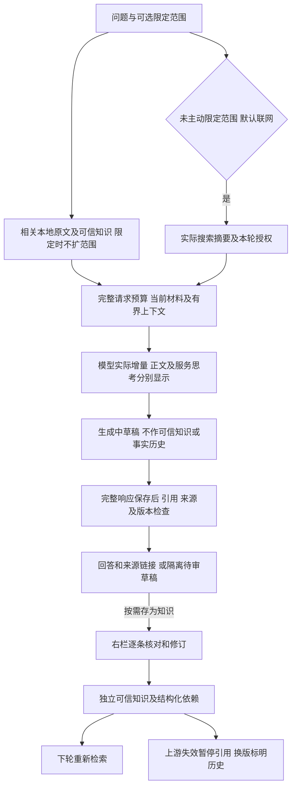
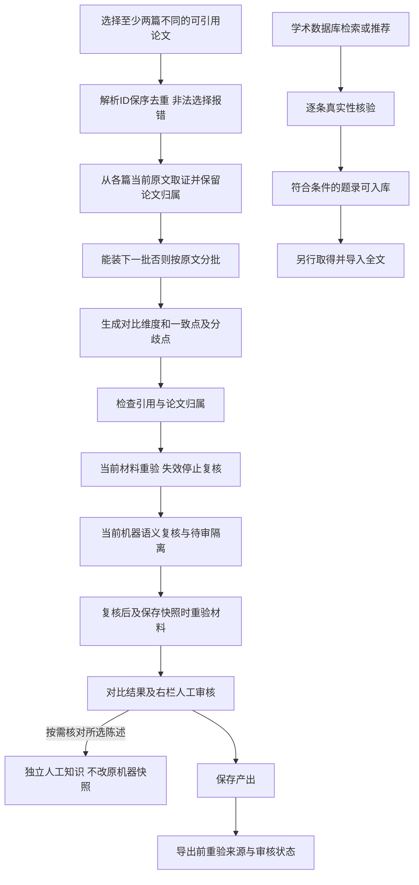

# M04 检索问答与研究

更新：2026-11-18。本页说明模块边界；后续实施顺序只维护在 [实现计划](../实现计划.md)。

## 聊天与来源交互：当前流程

辅助研究按“追问 → 补证 → 按需选择内容 → 语义核对后入库 → 下轮重新检索”进行。初读缺项、数量提示或兄弟单元未审，不阻止正常问答。执行完成、回答可用和知识确认是三种独立状态；一条知识确认不要求整答确认。2026-11-16已用真实界面和服务完成[架构对照与闭环验收](../渐进研究闭环架构对照与验收-2026-11-16.md)，按用户委托执行语义裁决并实际引用新知识，未引入新框架或自动审核闸门。

当前Web界面默认综合全库相关论文、人工确认知识与本轮实际搜索摘要，来源和审核状态分别标识。仅保留回答范围选择；主动指定论文/分组时只使用该范围，不额外联网。“仅依据”等明确来源指令同样限制；“只用左侧上下文”等内容描述不算来源限制。未选论文/空列表表示不限定，检索相关项而非全库全文全部送达。非法/已删除选择报错，已选空分组保留过滤。旧重点/严格API字段与既有会话、显式离线请求继续兼容，不批量改写。

首条消息保存前可修改范围，之后从顶部范围按钮新建不同范围的对话。范围限定当轮证据，已有有效对话与摘要继续用于理解指代和意图。输入区圆环显示最近一次模型问答的输入占用，展开可见系统提示、对话与摘要、本轮证据、问题与指令。占比按发送时的窗口与最终请求估算，服务报告输入有值时单列。见 [N04 长会话与上下文占用](../N04长会话与上下文占用验收-2026-11-18.md)。

明确选定论文时，完整当前材料装得下仍优先送达。默认全库先检索相关论文，再按实际请求窗口补齐命中论文的当前材料；多篇一起装不下时逐篇尝试，过大的论文尝试补齐命中章节，仍装不下保留片段。补齐时计入已有论文命中、可信知识和本轮网页，不以它们换取全文空间；未命中的论文不会因库小而自动全文加入。程序记录完整提供了哪些论文，完整材料仍不等于语义正确。历史和思考都不作本轮事实依据；服务实际返回的正文/思考增量实时展示，临时草稿不提前作为正式答案，完成后仍走来源/引用与版本校验。输入框草稿按会话跨刷新保留（localStorage 镜像，发送或删除会话即清除，存储不可用时降级仅内存），草稿只存客户端、不进请求体或知识。临时网页证据不自动获全库准入；候选列表有 URL 不等于已经取得网页正文。

辅助对应记录格式/缺项只提示，明确排版等价保留原文和位置；虚构编号、错页、来源失效及已知证据风险仍阻止相关结论。尚无可靠影响边界时保守隔离整答，不自动删句拼成修复答案。原句定位和 answered 不代表语义通过。

模型输入用带编号的正文起止边界区分各块，要求先复制该编号内的原句再写回答；相邻块分别引用，直接引句不得同义改写。边界计入输入预算，不改变原文、来源右栏或定位阈值。原稿回放和真实生成按日期分别保留，旧失败不回写；最新遵循与语义结论统一见状态页。

人工裁决后原回复和相关摘要退出后续上下文，修订知识重新检索；来源回收/撤销或传递依赖失效会影响其可用性，审核历史保留。完整接口、版本及边界见[M04当前契约](../M04对话侧缺口与设计-2026-10-21.md)。

追问现从有效历史及压缩覆盖消息的实际引用恢复当前论文/知识句柄，不重放原回答；材料换版、来源撤回或裁决失效时连同旧摘要排除。摘要仅解释指代和意图，内部检查点不显示成聊天消息，原问答和审计保留。恢复知识先计入材料预算，严格论文范围与旧网页授权不跨轮的边界保持。这是程序确定性恢复，尚非模型自主选择恢复工具。

问答按固定系统指令 → 本轮完整送达的论文原文 → 按顺序保留的有效历史 → 本轮补充证据和当前问题组装。完整论文按所选范围与稳定身份排序，篇内保持索引顺序。实时搜索、局部检索片段、送达清单和偏好位于后段。编号对应最终实际输入，来源失效和超窗预算优先处理。请求前缀及用量口径见 [N04 长会话验收](../N04长会话与上下文占用验收-2026-11-18.md#聊天请求的前缀组织)。

历史装不下时，Web 在发出问答前尝试压缩已完成的旧轮。选段和保护按完整问答处理，发送时优先保留最近完整问答及有效摘要。持久恢复复用本次已生成的检查点和精确请求。 [发送预算与压缩复验](../N04长会话与上下文占用验收-2026-11-18.md#完整问答与发送预算修复复验)

## 跨论文研究：当前流程

问答和对比默认读取当前材料，历史块只按原引用 ID 回溯；对比不复用旧解读作为事实证据。旧分析不能自动作为新材料的结论。题录入库不等于已下载全文；arXiv 与非 arXiv 开放副本可自动取全文（Unpaywall/OpenAlex/S2/EuropePMC，查不到明确失败），普通网页正文获取仍未接通。分组、标签、TF-IDF/术语关联用于管理与发现线索，不等同于真实引用网络。

[独立Compare验收](../N04独立多篇对比验收-2026-11-16.md)走通两篇118块、原生复核、受托单条确认、保存/导出和撤回409；2026-11-18用原始响应离线复验C1–C4。此入口为普通任务，内存重绘不等于跨重启恢复。复核按实际窗口安排；优先同批全文，放不下时尝试保留每条完整候选片段，仍放不下便待核对。论文单元格的支持和反证只能用其所属论文的候选原文。当前页面区分待核对、未提及和人工裁决，核对集中在右栏；单条知识确认独立保存，报告显示生成时的快照，原机器记录保持。没有原始判定的11条保持待核对，不当作语义失败或成功。

Skill 是声明式扩展，调用内核检索/上下文与产出守卫，不能执行任意代码或取消引用检查；不因 P 系列实现就自动获得六字段同等语义保证。产出预览、单项/批量导出均须保留来源状态边界。

依据：`agents.py:CompareAgent` / `RecommendAgent`、`comparison.py`、`deliverables.py`、`skills/runner.py`、`web/workflows.py`。

来源发现、推荐结果的材料取得边界统一见 [M01](01-来源发现与候选.md) / [M02](02-论文与网页资料入库.md)，可信知识与导出见 [M05](05-知识沉淀与产出.md)。每轮保留范围快照、送达范围、状态及用量；概览和章节仍可能因窗口裁减，界面明确提示。复杂指代没有完成语义改写，当前优先用历史实际引用定位论文身份。

题录摘要也可成为召回证据；此时结论只能限于该摘要提供的信息，不能冒称已依据全文。

## 回复人工整理（已实现）

新回复及真实来源快照 → 回复后单一入口 → 右栏逐条证据/修订 → 来源与版本重验 → 独立人工知识或拒绝/撤销。主区连续原答保持可读，兄弟单元不连带确认；补充上下文需明确选择。旧无可靠绑定的记录不猜测补造，整答/单元首次裁决模式互斥。

人工裁决后原答及覆盖它的摘要退出后续事实输入；新知识由正常检索取得。修订撤旧存新、上游撤销/换版和派生可用性沿结构化依赖处理。全部已处理不等于整答客观正确，证据摘录可完善不计事实错误。

## 持久请求与续验（已实现）

新Web先登记调用、存响应/用量，再原子发布回复与审核快照；刷新/重启不自动重发。精确成功复用，失败/未知明确重试；输入/模型/来源/实现变更要求新问题，旧API不自动获得恢复。接口和字段见[M04契约](../M04对话侧缺口与设计-2026-10-21.md)、[持久化契约](../N04对话请求持久化与续验-2026-10-23.md)。

## 当前进度与待验

[术语入口限定验收](../N04术语入口验收-2026-11-18.md)使用两篇固定全文的首次响应，已验证各自术语表、手动查原文及进入严格单篇对话。术语页没有独立跨论文比较；编号和页码通过不保证语义，术语引文加载原分析版本对应块；通用含义与论文用法、缺证状态分开，全文只提取一次；新格式的真实学术质量另验，见实施计划。

同次QA的question_items/addresses已接通，内部记录不进正文，只检查模型声明后的关联，不认证必答项完整性或语义。最新4轮严格范围比较/实际追问/简答/局部证据缺口主要目标满足；完整回归与用量见[状态页](../当前实现与验收状态.md)。BERT“无标注数据”同块有据，仅[证据摘录可完善](../N04多轮追问与受控压缩验收-2026-10-24.md#无标注数据表述与证据摘录对照)。

G04补充了每项/总计的数值量词提示，并区分整体不足与局部未知。新格式混合回答通过已有来源/风险检查后，可依据已绑定的实质正文和显式缺口记录展示可用性；不因模型的全局不足标志直接拒绝整答。程序记录不认证语义或问题项完整性，不使用内部问题项关联作放行依据；元数据、纯缺口及已知风险仍沿原路径。原始L3离线回放、来源撤销及L1/L3两题实际复验见[G04报告](../G04限定学术质量验收-2026-10-29.md)，不能替代六字段解读或通用语义验收。

默认全库联网与真实追问2轮首次组合验收的主要目标满足，见[报告](../history/N04默认联网与真实追问验收-2026-10-26.md)。随后收口默认概述/比较误扩全库：实际问题原词/有效追问来源确定相关论文，无命中时保留正常扩展；真正多篇与明确全库概览保持，知识/网页不丢失。原四篇单篇254→65、两篇254→136块，旧付费两轮回放不变；词法噪声不冒充完美相关性。扩展字段类型也已收口，只用列表中非空字符串，缺失/非法字段和服务异常维持词法回退，不追加重试。当前整理提交，队列只看[实施计划](../实现计划.md)。其余质量/体验边界保留登记，不自动开工；不增加embedding、全量复核或泛化整答硬拦。原24题及逐轮记录见[报告索引](../README.md#验收报告与历史证据)。
