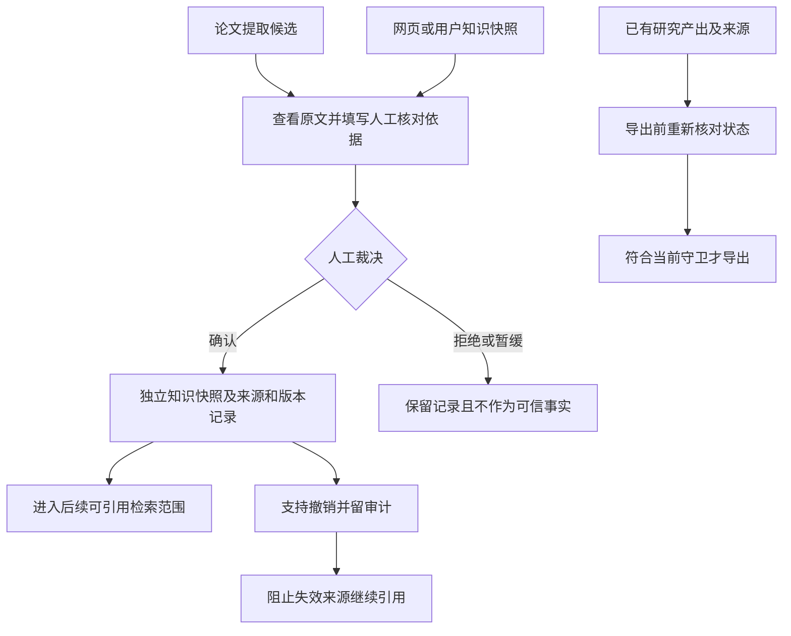

# M05 知识沉淀与产出

更新：2026-10-24。本页说明模块边界；“当前实现”与“修订目标/缺口”分开，后续实施顺序只维护在 [实现计划](../实现计划.md)。N05/N06 与 N12 的最新验证见 [实施记录](../N12原文材料版本化-2026-10-20.md)。

## 当前对象与路径

知识输入不只来自论文解读，还包括用户直接提供的知识、网页摘要/正文快照及后续研究结果。来源类型、内容范围与审核依据必须保留，不能统一改称“论文事实”。

| 输入 | 当前审核与沉淀方式 | 重要边界 |
|---|---|---|
| 六字段解读/对比的机器陈述 | 右栏绑定分析版本与陈述 ID，可修正后确认并生成独立知识快照 | 原机器结果保留；机器支持与人工确认分别记录 |
| 手工知识或网页快照 | 先 `pending`，人工核对后 `manual_confirmed` | URL 存在或搜索命中不等于正文已获取或信息真实 |
| 研究产出 | 保存草稿/报告并保留来源映射，导出时重验 | 保存交付物不自动将每句正文转成可信知识 |

人工确认不是不可撤销的真理证明；来源失效、论文回收或快照撤销应影响后续问答、对比和导出。普通 QA 没有六字段同等逐条机器语义保证。

## 当前知识沉淀与剩余缺口

提取完成后、机器复核前的候选持久化与直接人工审核已接通，提取过程中逐条即时落库尚未实现，见 [M03](03-阅读提取与协作审核.md)。N05 人工漏提补录与 N06 质量面板已实现；已采集漏提占比不是完整召回率。N12 保留历史材料/分析与审核哈希，补录必须绑定对应分析材料。旧分析不作为当前材料结论导出，不能凭知识条目数量宣称提取完整。

N08 备份保留来源快照、审核/撤销、补录、历史材料/分析和产出；恢复不重新赋予可信状态，仍受原有来源守卫约束，见 [备份恢复契约](../N08备份恢复与目录迁移-2026-10-20.md)。

本页负责沉淀与使用边界；具体字段和审核契约见 [证据交互契约](../证据交互契约.md)，验收与后续实施只看统一状态/计划，不另建任务队列。

依据：[`knowledge.py`](../../src/litprism/knowledge.py)、[`web/semantic_routes.py`](../../src/litprism/web/semantic_routes.py)、[`web/evidence_routes.py`](../../src/litprism/web/evidence_routes.py)、[`deliverables.py`](../../src/litprism/deliverables.py)。

## 对话知识与依赖（schema v15）

新 chat 人工修订可针对本轮实际取得的网页摘要生成独立知识，不顺带确认整份网页。知识保存结构化原文/材料/快照依赖，使用时计算当前可用性；上游撤销/回收/拒绝或变化使其待复核，材料换版标历史，原确认记录不删除。传递依赖同样检查，独立知识不受无关来源失效影响。旧派生知识无结构化关系时不猜测补齐。

新知识参与下一轮正常检索，包括原论文重点会话；严格仅限来源保留限制。多来源知识暂按一次人工确认的自足条目处理，不自动断言剩余依据可替代。修订可通过依据当前原文重新提问/审核生成新知识，旧知识保留或撤销。参见[M04](../M04对话侧缺口与设计-2026-10-21.md)。

派生知识只索引人工修订正文，完整出处和审核说明保留在审计快照/依赖中；确认一条知识不会把附带原文的其他陈述一并加入可信检索。

## 六字段质量状态

质量面板与CLI始终保留六字段，字段缺席不再消失。未解读、当前解读未提取、已有机器陈述但未审核、部分已审、已审及机器未提取但有人补录分别显示。尚无人工质量样本时也能看字段表，`has_data`只说明是否有审核/补录样本，不控制表格显隐。

分母为0仍为None；零机器陈述的字段覆盖列显示未解读/未提取，不显示虚构0%。已有机器陈述但无人审核的覆盖仍是实际0%。人工补录不改变机器条数或原接受率口径，已采集漏提占比仍不是完整召回率。没有自动判定not_applicable，也不因缺席删改指标分母。

对话单元可作为独立人工修订知识入库，只索引人审正文并保存明确证据范围/依赖；不索引未审兄弟或原始草稿。修订建立新版本并撤销旧知识，下游依赖随之失效；通用来源确认不能复活旧单元版本。父回复及单元历史保留，整答与单元模式互斥，不连带确认其他内容。schema仍v15，恢复后仍可撤销；见[M04单元裁决](../M04对话侧缺口与设计-2026-10-21.md#单元级人工裁决与知识依赖已实现)。
