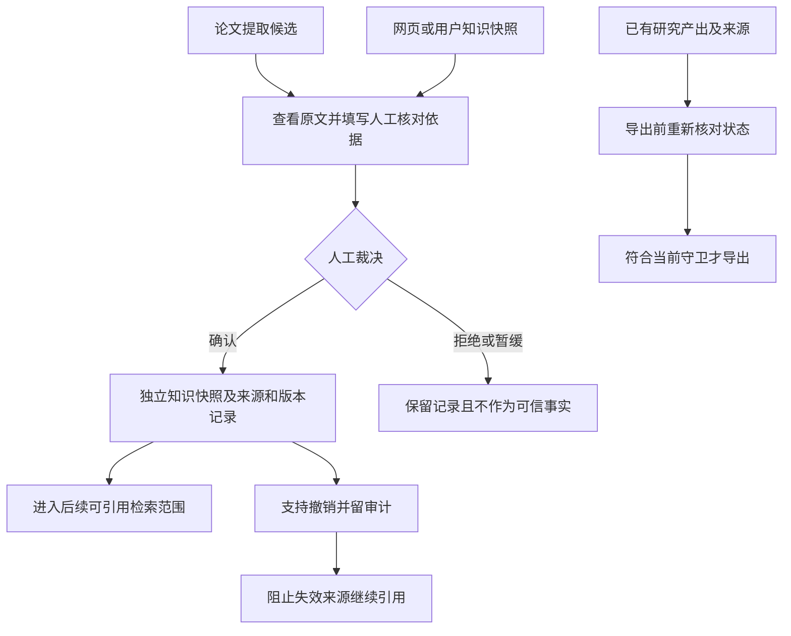

# M05 知识沉淀与产出

更新：2026-10-20。本页说明模块边界；“当前实现”与“修订目标/缺口”分开，后续实施顺序只维护在 [实现计划](../实现计划.md)。N05/N06 与 N12 的最新验证见 [实施记录](../N12原文材料版本化-2026-10-20.md)。

## 当前对象与路径

知识输入不只来自论文解读，还包括用户直接提供的知识、网页摘要/正文快照及后续研究结果。来源类型、内容范围与审核依据必须保留，不能统一改称“论文事实”。

| 输入 | 当前审核与沉淀方式 | 重要边界 |
|---|---|---|
| 六字段解读/对比的机器陈述 | 右栏绑定分析版本与陈述 ID，可修正后确认并生成独立知识快照 | 原机器结果保留；机器支持与人工确认分别记录 |
| 手工知识或网页快照 | 先 `pending`，人工核对后 `manual_confirmed` | URL 存在或搜索命中不等于正文已获取或信息真实 |
| 研究产出 | 保存草稿/报告并保留来源映射，导出时重验 | 保存交付物不自动将每句正文转成可信知识 |

人工确认不是不可撤销的真理证明；来源失效、论文回收或快照撤销应影响后续问答、对比和导出。普通 QA 没有六字段同等逐条机器语义保证。

## 与修订目标的差距

现有审核接口已接通，但“提取候选一产生就可审核、机器为可选后台辅助”的完整工作流仍待补，见 [M03](03-阅读提取与协作审核.md)。N05 人工漏提补录与 N06 质量面板已实现；已采集漏提占比不是完整召回率。N12 保留历史材料/分析与审核哈希，补录必须绑定对应分析材料。旧分析不作为当前材料结论导出，不能凭知识条目数量宣称提取完整。

N08 备份保留来源快照、审核/撤销、补录、历史材料/分析和产出；恢复不重新赋予可信状态，仍受原有来源守卫约束，见 [备份恢复契约](../N08备份恢复与目录迁移-2026-10-20.md)。

本页负责沉淀与使用边界；具体字段和审核契约见 [证据交互契约](../证据交互契约.md)，验收与后续实施只看统一状态/计划，不另建任务队列。

依据：[`knowledge.py`](../../src/litprism/knowledge.py)、[`web/semantic_routes.py`](../../src/litprism/web/semantic_routes.py)、[`web/evidence_routes.py`](../../src/litprism/web/evidence_routes.py)、[`deliverables.py`](../../src/litprism/deliverables.py)。
