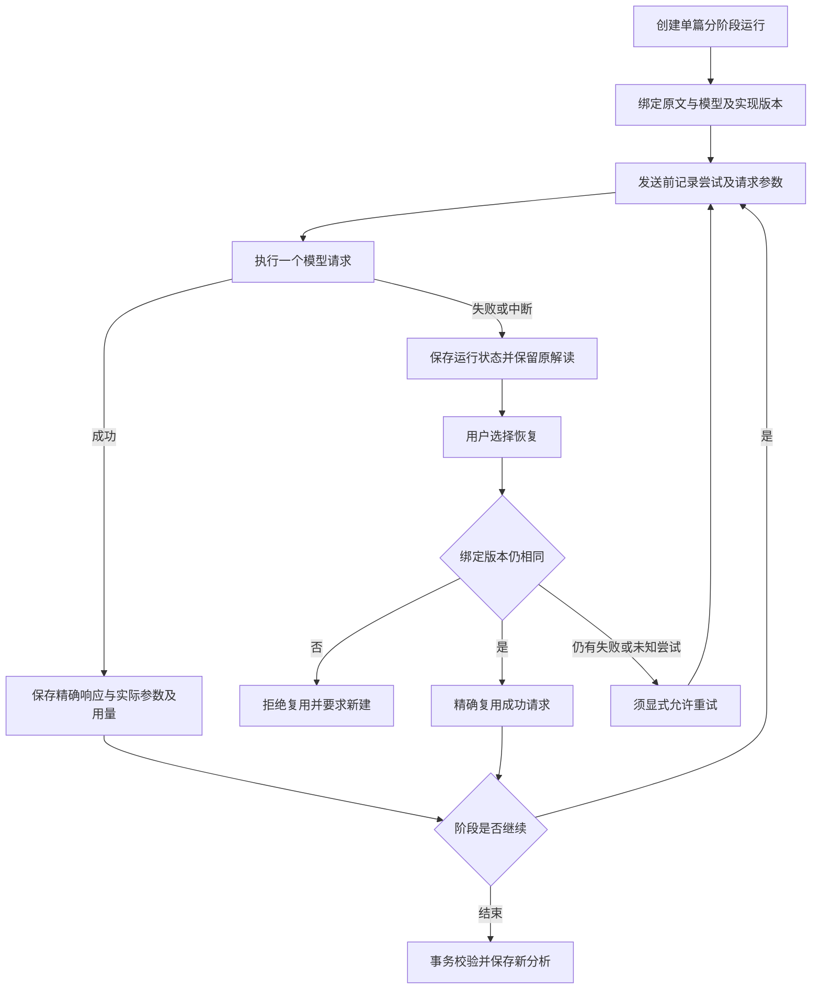

# M06 模型运行与数据管理

更新：2026-10-25。本页说明模块边界；“当前实现”与“修订目标/缺口”分开，后续实施顺序只维护在 [实现计划](../实现计划.md)。

## 基础职责

- 模型提供商、协议、SecretStore 密钥引用、API 能力缓存与只读展示；能力数据不是文献内容来源。
- Flash 的 1M 上下文与 384K 最大输出数据、自动分配和独立思考展示，见 [能力契约](../模型能力与思考展示-2026-10-19.md)。不提供手工输出额度编辑控件。
- 本地 SQLite/FTS、来源快照与审计、会话/摘要/偏好、分组与回收；应用数据根与源码隔离。
- 旧聊天API、旧重新解读、对比、Skill不自动具备N01的持久恢复；新Web聊天另有请求持久化与显式续验。CLI/MCP现与Web共用同根ProviderStore选模，stdio/退出已做本机隔离验收；这不增加旧入口持久恢复能力。
- N08 已接全库一致备份、新目录恢复与复制迁移、重启切换及取消；F3 安装交付仍未完成，本轮不打包。

## N01 持久运行：当前流程

论文详情选择“分阶段解读”，按需关闭术语或机器复核；当前不再填写阶段调用上限。失败、取消或中断后，从运行记录检查并恢复；失败或结果未知的尝试须显式允许重试。刷新或重开应用只读记录，不自动发请求。提取完成已保存的ac_候选可直接人工核对，关闭机器或后续复核失败不必阻断该人工路径，仍须绑定材料和分析版本；不是每条指令完成即落候选，见 [M03](03-阅读提取与协作审核.md)。

阶段调用上限已取消，次数仅作实际用量记录。失败/中断保存运行状态并保留原解读。成功响应精确复用，失败或 `started` 不自动重发；回放不算新质量样本。只有 N01 新入口具备这套完整持久运行路径，不能把它推广到旧重新解读、旧QA/API、对比、Skill 或一次性 CLI/MCP。

依据：`analysis_runs.py`、`web/analysis_run_routes.py`，当前操作与恢复契约见[N01持久解读与续验](../阶段预算与可续验进度-2026-10-18.md)。

N12 已加入材料绑定及历史分析归档；重新导入后原 N01 来源绑定变化，不得复用旧材料请求。N08 已实现，托管原文可选、密钥不迁移；原N07已取消，当前任务顺序见实施计划。真实语义验收不自动启动，见 [N12 契约](../N12原文材料版本化-2026-10-20.md)。

备份/恢复的文件范围、预检、失败回滚、原连接保持与缺密钥行为见 [N08 契约](../N08备份恢复与目录迁移-2026-10-20.md)。

新Web聊天已接独立的持久请求/响应/用量记录，失败或未知尝试需明确重试，精确成功响应复用。聊天持久表最初在schema v14加入，当前整体schema为v15；状态读取先捕获活跃标志，避免旧状态与新inactive拼接。接口、备份与旧入口边界见[QA持久化契约](../N04对话请求持久化与续验-2026-10-23.md)，本次固定真实验收与收尾竞态修复见[冻结版报告](../N04冻结版24题验收-2026-10-23.md)。

2026-10-24 对话补充：实际搜索摘要可以通过本轮授权作为明确未审核的外部证据，与可信库材料同时使用；不等于自动取得网页正文或自动可信入库。schema v15 另存知识依赖与本轮授权，纳入N08备份；当前流程与边界见[M04](../M04对话侧缺口与设计-2026-10-21.md)。

## N09 统一选模与stdio边界

Web、CLI、MCP采用同一数据根的当前提供商/模型、协议和能力数据，Key仍只走SecretStore。仅明确mock配置在未选模型时可离线占位；所选模型失效不自动回退。MCP每次ask重新解析当前选择，检索工具不要求模型可用；CLI诊断明确基础配置与当前模型状态。

模块和CLI两种stdio入口均支持显式配置，stdout仅协议、诊断走stderr，退出按连接所有权回收。只读模式隐藏写工具，逻辑失败带isError/ok=false和审计原因；指定配置缺失/为空或无效CLI论文选择不得回落其他库/全库。已用本机SDK2.3.0完成握手、工具/资源调用、模式守卫、两协议本机HTTP桩与正常退出验收，详见[N09报告与使用方式](../N09配置与集成验收-2026-10-24.md)。

CLI/MCP的一次性问答仍是本地内核入口，不自动联网，也不提供持久Web对话的人审/续验；MCP对比只读取当前已存分析，与Web模型对比不同。宿主客户端安装、远端服务稳定性与跨机器环境尚未扩大验收。

## N10体验与管理边界

设置采用原生模态对话框，Tab留在当前任务、Escape只关闭最上层、关闭后归还焦点；窄屏导航覆盖工作区并在进入页面后收起。搜索/分组筛选移除不可见的勾选，批量动作不会继续作用于被隐藏的文献；导出弹窗固定本次选择，不因后台清空勾选回退全库。文献刷新清空对比缓存/来源；执行期间的文献变化、改选及更新请求使迟到结果失效。

分组移动/拖动/排序、删父组保留子组、回收后检索排除、恢复后原材料身份与检索恢复均在隔离API/UI验收；这不替代N08全库恢复。详见[N10报告](../N10体验与管理验收-2026-10-25.md)。窗口普通几何与最大化偏好现已保存至独立数据根的`window-state.json`，按当前显示器工作区恢复；负坐标、拔屏、小屏/最小尺寸、原子写失败和关闭清理已通过31项Node模拟，真实Electron实机另验。该文件仅窗口缓存，不进入知识备份，不含token/内容；损坏可回退默认。流式、系统通知和托盘未纳入，F3仍暂停。
