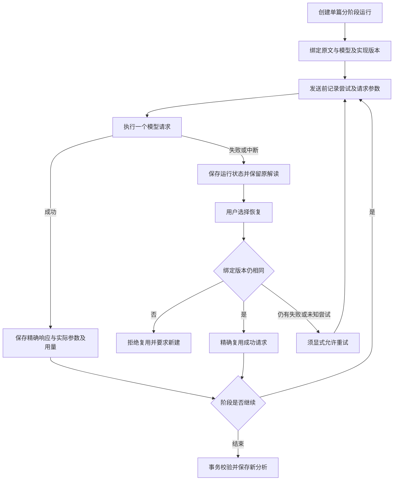

# M06 模型运行与数据管理

更新：2026-10-20。本页说明模块边界；“当前实现”与“修订目标/缺口”分开，后续实施顺序只维护在 [实现计划](../实现计划.md)。

## 基础职责

- 模型提供商、协议、SecretStore 密钥引用、API 能力缓存与只读展示；能力数据不是文献内容来源。
- Flash 的 1M 上下文与 384K 最大输出数据、自动分配和独立思考展示，见 [能力契约](../模型能力与思考展示-2026-10-19.md)。不提供手工输出额度编辑控件。
- 本地 SQLite/FTS、来源快照与审计、会话/摘要/偏好、分组与回收；应用数据根与源码隔离。
- 普通聊天、旧重新解读、对比、Skill 不自动具备 N01 的持久恢复；完整 CLI/MCP 与桌面选模尚未统一。
- N08 已接全库一致备份、新目录恢复与复制迁移、重启切换及取消；F3 安装交付仍未完成，本轮不打包。

## N01 持久运行：当前流程

论文详情选择“分阶段解读”，按需关闭术语或机器复核；当前不再填写阶段调用上限。失败、取消或中断后，从运行记录检查并恢复；失败或结果未知的尝试须显式允许重试。刷新或重开应用只读记录，不自动发请求。关闭机器后的候选直接确认仍欠 N03，见 [M03](03-阅读提取与协作审核.md)。

阶段调用上限已取消，次数仅作实际用量记录。失败/中断保存运行状态并保留原解读。成功响应精确复用，失败或 `started` 不自动重发；回放不算新质量样本。只有 N01 新入口具备这套完整持久运行路径，不能把它推广到旧重新解读、QA、对比、Skill 或全部 CLI/MCP。

依据：`analysis_runs.py`、`web/analysis_run_routes.py`，持久恢复原始设计与当时证据见[阶段预算与可续验进度](../阶段预算与可续验进度-2026-10-18.md)。

N12 已加入材料绑定及历史分析归档；重新导入后原 N01 来源绑定变化，不得复用旧材料请求。N08 已实现，托管原文可选、密钥不迁移。下一项为 N07；真实语义验收不自动启动。见 [N12 契约](../N12原文材料版本化-2026-10-20.md)。

备份/恢复的文件范围、预检、失败回滚、原连接保持与缺密钥行为见 [N08 契约](../N08备份恢复与目录迁移-2026-10-20.md)。
