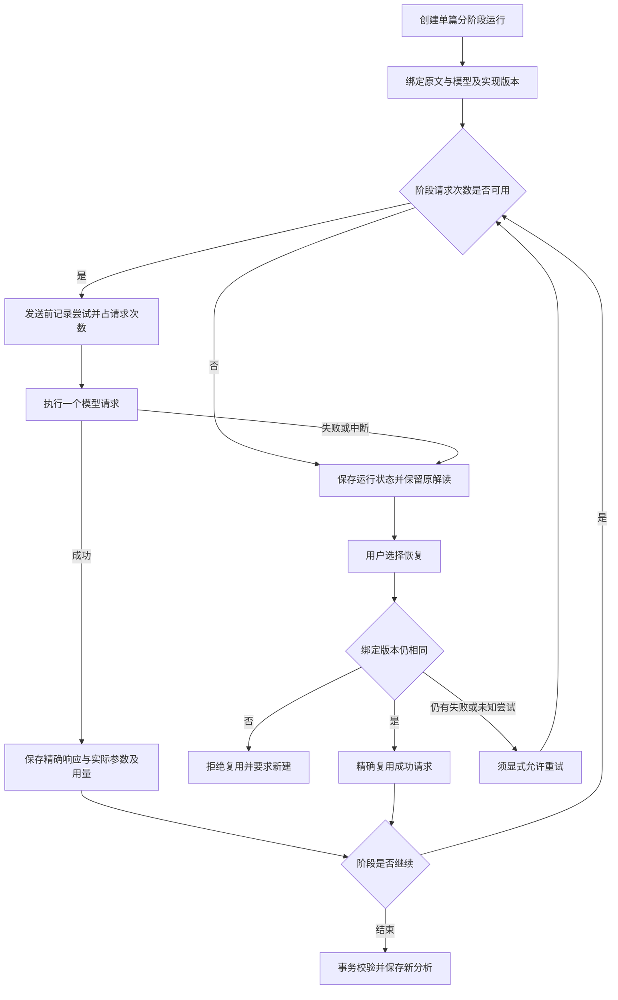

# M06 模型运行与数据管理

更新：2026-10-19。本页说明模块边界；“当前实现”与“修订目标/缺口”分开，后续实施顺序只维护在 [实现计划](../实现计划.md)。本轮只整理文档。

## 基础职责

- 模型提供商、协议、SecretStore 密钥引用、API 能力缓存与只读展示；能力数据不是文献内容来源。
- Flash 的 1M 上下文与 384K 最大输出数据、自动分配和独立思考展示，见 [能力契约](../模型能力与思考展示-2026-10-19.md)。不提供手工输出额度编辑控件。
- 本地 SQLite/FTS、来源快照与审计、会话/摘要/偏好、分组与回收；应用数据根与源码隔离。
- 普通聊天、旧重新解读、对比、Skill 不自动具备 N01 的持久恢复；完整 CLI/MCP 与桌面选模尚未统一。
- 全库一致备份恢复、目录迁移和 F3 安装交付尚未完成；本轮不启动打包。

## N01 持久运行：当前流程

请求次数预算与输出 token 能力是两件事。成功响应精确复用，失败或 `started` 不自动重发；回放不算新质量样本。只有 N01 新入口具备这套完整持久运行路径，不能把它推广到旧重新解读、QA、对比、Skill 或全部 CLI/MCP。

依据：`analysis_runs.py`、`web/analysis_run_routes.py`，完整契约见[阶段预算与可续验进度](../阶段预算与可续验进度-2026-10-18.md)。
