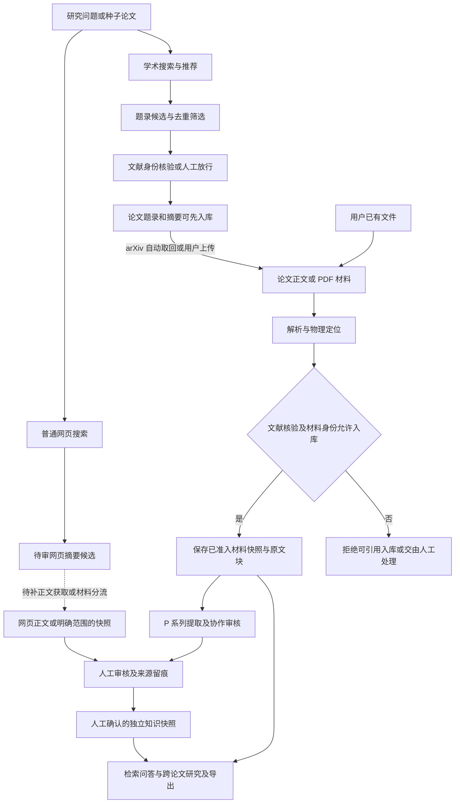

# 当前设计与主要功能流程图

更新：2026-10-24。功能文档已按模块拆分，完整入口见 [六个功能模块](modules/README.md)。下面补齐来源发现、材料入库与知识沉淀之间的前后关系。统一候选池、arXiv 全文获取、N12 材料版本化、N08 备份恢复及 N03 复核前候选持久化与直接人工审核已接通；普通网页正文仍待接线。真实语义状态以 [当前状态](当前实现与验收状态.md) 为准。

## 从发现材料到知识沉淀：端到端目标

这张图描述模块关系，**不是全部已经接通的现状**；虚线表示尚缺的普通网页正文获取接线。

普通网页候选当前也可直接审核保存的摘要快照，但不能把摘要称为已抓取的网页正文。统一候选池与解析文本版本化已接通；普通网页正文获取及更复杂的网页论文分流仍待补。详情见 [M01](modules/01-来源发现与候选.md) / [M02](modules/02-论文与网页资料入库.md)。

## 模块阅读顺序

| 模块 | 设计与当前流程 |
|---|---|
| M01 | [来源发现与候选](modules/01-来源发现与候选.md)：数据源角色、搜索/推荐与前置筛选缺口 |
| M02 | [论文与网页资料入库](modules/02-论文与网页资料入库.md)：文件、题录与网页三条路径，材料完整度与获取缺口 |
| M03 | [阅读提取与协作审核](modules/03-阅读提取与协作审核.md)：P 系列现状、人工与可选全文批量辅助目标 |
| M04 | [检索问答与研究](modules/04-检索问答与研究.md)：RAG、来源链接、跨论文比较与关联 |
| M05 | [知识沉淀与产出](modules/05-知识沉淀与产出.md)：人工确认、独立快照、撤销和导出重验 |
| M06 | [模型运行与数据管理](modules/06-模型运行与数据管理.md)：能力、任务用量、N01 恢复和本地隔离 |

N08 作为 M06 的数据安全能力覆盖材料、引用、审核、知识与产出：在线快照 → 清单预检 → 恢复到新目录 → 用户安排重启切换。它不绕过人工审核，也不把旧材料升级为当前材料；完整流程见 [N08 契约](N08备份恢复与目录迁移-2026-10-20.md)。

## “入库”与“全文”的口径

候选暂存、论文材料入库、可信知识沉淀是三个状态。论文库可能只有题录/摘要，也可能拥有已解析原文；不是每次“论文入库”都意味着完整 PDF 到位。搜索结果是前置入口，P 系列只是取得材料后的阅读路径。全文前缀指全部已索引材料；材料是否真为论文全文需要单独识别。

## 当前每类请求输入什么

| 当前请求 | 实际输入 | 与 P 系列关系 |
|---|---|---|
| 六字段提取 | `whole` 时为完整已索引原文前缀 + 本次目标范围；超窗时为该批原文 | P-1/P-2 主路径；一次指令仍使用六字段协议，不固定六次调用 |
| 术语提取 | 对应提取单元的全文或该批原文 + 术语指令 | 另一次调用；不经过与六字段相同的逐条语义复核 |
| 语义复核 | 能力已知时复用全文前缀、按窗口批量；能力未知时为逐条小来源路径 | 候选逐条保留判定，批量发送不等于逐条调用 |
| 差异复核 | 同字段陈述；能力路径可加入全文并按窗口分 tile | 同批/跨批均检查；不是跨字段全量一致性保证 |
| 聊天 QA | 新Web默认综合全库相关论文、可信知识及本轮实际取得的网页摘要；先检索，已知窗口下尝试补齐命中论文当前材料，装不下按逐篇/命中章节/片段兜底，保留其他证据。可选严格论文范围，装得下优先完整当前材料，不额外联网；旧重点API继续兼容。加有界历史/偏好 | 原文先于历史和问题尾部；稳定句柄用于追问恢复，P 系列没有取消检索兜底；完整提供不等于语义正确 |
| 跨论文对比 | 按原文顺序组织的多论文片段，能装下则一批，否则完整分批 | 从原文比较，不把先前解读当事实；不是单篇 `Directive` 计划 |
| 偏好与摘要 | 会话上下文中的偏好、历史或待摘要消息 | 不属于全文读论文协议；偏好不能作为事实证据 |

依据：[`extract.py`](../src/litprism/extract.py)、[`reading.py`](../src/litprism/reading.py)、[`semantics.py`](../src/litprism/semantics.py)、[`agents.py`](../src/litprism/agents.py)。这里的全文指当前已索引原文；不意味着扫描图片、复杂表格和全部 PDF 版面已被可靠理解。

## 文档冲突核对与更正

| 原说法或容易误读之处 | 核对结果与更正 | 类型 |
|---|---|---|
| 原设计“按章节优先级截断正文” | P 主路径改为有序全文前缀，超窗完整分批并报告覆盖 | 旧设计被替代 |
| “按六字段分别调用六次” | 这是中间提议；当前每条范围指令仍按六字段协议提取 | 未采纳方案 |
| “所有 API 请求都用全文” | 提取可用全文；QA、逐条复核、差异复核输入不同，见上方请求输入表 | 范围错误 |
| “P 系列取消了 RAG” | QA 仍基于原文检索；原文块还承担定位、引用、审核与来源稳定性 | 并非冲突 |
| “逐条小片段复核是产品必选主线” | 能力感知全文批量和开关已有；全部提取完成后先独立保存候选，关闭/失败可直接人工审核 | 协作闭环已接通，复杂来源质量仍待验收 |
| “截断自动对半拆指令并重跑” | 当前未实现；截断记录未覆盖/待审，N01 可保存失败状态 | 文档完成度错误 |
| “固定 44 条或固定 60%/70% 窗口阈值” | 配额仍为内部经验估算；是否装得下按完整消息与可用窗口判断 | 过时常数 |
| “同一批生成不可能矛盾，故零差异调用” | 同批也可能矛盾；当前同字段桶内包含同批检查 | 错误推论/未采纳方案 |
| “旧解读直接作为多篇对比事实” | 当前重新从原文取证，检查论文归属并复核 | 旧设计被替代 |
| “人工确认尚未实现” | 文献真实性白名单、来源快照及语义陈述审核已存在；复核前持久化候选也可独立审核 | 不得将人工确认与机器支持混为一谈 |
| “缓存命中或条数达标证明理解正确” | 只能证明对应技术指标；不能证明语义或漏读情况 | 保证范围错误 |
| “Tauri、embedding 与安装包仍默认推进” | Electron 路线；有历史安装包产出而 N11 未验收；本轮不打包，不增 embedding；真实语义固定复验单独留档 | 后续决策覆盖 |

原设计保留需求与历史实测，已替代的方案在原文相应位置标明。本轮已接通的具体差距与验证范围见各模块，复杂语义质量仍未整体通过。当前能力、测试数量和真实质量状态以[当前实现与验收状态](当前实现与验收状态.md)为准，后续任务只登记在[实现计划](实现计划.md)，避免再维护一套互相冲突的计划。

对话新增独立人工知识路径：新回复及本轮真实来源快照 → 回复后的审核链接 → 右栏查看草稿/原文 → 人工选择来源、修订正文、填写依据 → 版本与引用重验 → 独立可信知识或拒绝/撤销。人工裁决使原回复及相关旧摘要退出事实投影；历史消息不猜测补建来源。此路径已通过离线API与无窗口交互，完整流程图见 [M04模块](modules/04-检索问答与研究.md#回复人工整理已实现)，真实语义质量仍按专项报告判断。

2026-10-24 用户确认的混合取证已接通：本地可信材料/知识与本轮实际搜索摘要共同回答，来源和审核/取得范围分别标示；人工裁决后的新知识参与后续检索，结构化来源依赖影响当前可用性。尚无普通网页正文抓取、通用冲突判定或可靠逐句局部放行保证；详见[M04当前流程](M04对话侧缺口与设计-2026-10-21.md)。
