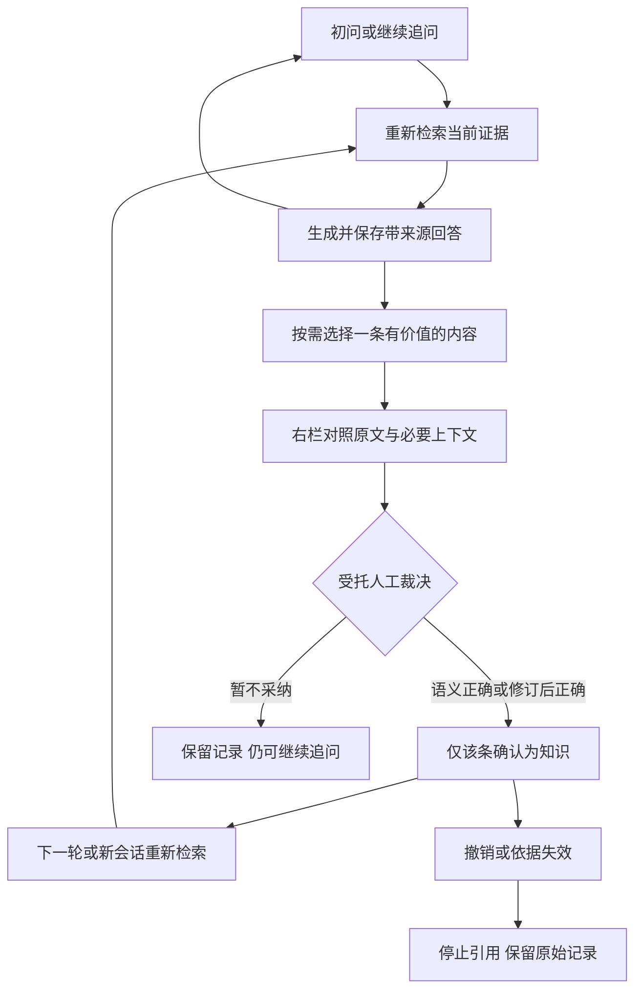

# 渐进研究闭环：架构对照与端到端验收

2026-11-16。本轮只检查“追问 → 补证 → 选择内容 → 确认入库 → 后续重新检索”。不引入 LangChain/LangGraph、不扩展模型自主研究循环、不增加本地 embedding，不要求论文初读一次完整或整答全部审核后才继续研究。执行队列仍以[实现计划](实现计划.md)为准。

## 使用与裁决口径

用户可以正常阅读带来源的回答、继续追问，并只整理有价值的内容。六字段缺项、数量提示或其他单元尚未整理，不阻止这条路径。可信知识准入按所选内容独立处理。

用户于本轮明确委托代理执行人工裁决。裁决以语义、对象、条件和数值范围正确为准，接受忠实转述，不要求措辞逐字相同或补齐所有附加细节。锚点用于定位实际原文，定位成功不额外代表语义认证；裁决记录保存核对依据。已知来源不存在、材料失效或引用对象错误仍须修正。此次写入仅发生于隔离验收库。

## 与成熟架构的范围对照

参考 2026-11-16 查阅的官方 [LangGraph 概览](https://docs.langchain.com/oss/python/langgraph/overview)和[持久化说明](https://docs.langchain.com/oss/python/langgraph/persistence)。官方将运行时状态持久化与跨会话存储分开，并提供显式控制流、流式事件及人工介入。下表是职责对照，不表示当前项目依赖、复制了该框架，亦不表示两者恢复语义完全相同。

| 关注点 | 成熟架构模式 | LitPrism 现状与实际边界 |
|---|---|---|
| 状态与控制流 | 节点读写明确状态，按条件转移 | QA 是显式程序流程：构造历史 → 当前证据检索 → 生成 → 引用/版本检查 → 原子发布；后续研究由用户追问推动 |
| 持久执行 | 保存会话执行状态，失败后按约定恢复 | `ChatRuns` / `ChatJournal` 保存请求、调用与结果；同请求回执不重发，失败/未知须显式重试；不是任意节点通用图检查点 |
| 人工介入 | 保存待审状态并允许确认、修改或拒绝 | 已发布回复有独立不可变审核快照；单元审核是另外的事务，不把整个聊天暂停在某个图节点 |
| 跨会话知识 | 长期存储独立于短期会话状态 | `evidence_sources` / `evidence_chunks` 存人审正文、状态和依赖；确认后通过检索读取，不靠直接改写模型历史 |
| 来源与执行身份 | 状态、输入和副作用有稳定身份 | `request_id` / 运行 ID / 审核快照哈希 / 单元 ID / 原文块和材料 ID / 审核令牌分别承担幂等、定位与并发约束 |
| 流式输出 | 运行中的事件与最终结果分开 | 现有草稿流不是可信知识；完成并检查后发布，刷新读取不追加调用 |
| 自主补证 | 模型可决定再检索或调用工具 | 本轮路径依靠用户追问与程序检索；没有通用自主循环。它不构成人工辅助研究路径的缺口 |

本轮不需要为了形式一致新增图执行引擎。应以这条现有流程的实际可达性和状态一致性为依据，再判断未来是否需要运行时替换。

## 接口与状态分工

| 步骤 | 接口/代码 | 状态及约束 |
|---|---|---|
| 追问登记 | `POST /api/conversations/{cid}/chat-runs` | 持久请求 `queued → running → completed`；这是执行完成，不等于全答正确或知识已入库 |
| 补证与回答 | `QAAgent.ask` / `build_dialogue` / `qa_retrieval.retrieve` | 每轮重新取得当前证据；历史用于指代，不是新事实；结果可为 `answered` 或局部缺口，不要求 N01 解读通过 |
| 查看结果 | `GET /api/chat-runs/{rid}/result` / 会话消息接口 | 按当前来源和审核记录投影；读结果不重发；来源后来失效可使旧答案停止正常引用 |
| 选择内容 | `GET /api/chat-reviews/{rid}` / `/units/{uid}` | 右栏显示可靠绑定的回答单元；`unreviewed` 表示尚未整理入库，不是断言正文错误 |
| 查看原文 | `GET /api/chat-reviews/{rid}/units/{uid}/sources/{tag}` | 返回真实来源、物理页、细锚点和前后文；原模型选择与人工补选分别保留 |
| 确认或修订 | `POST /api/chat-reviews/{rid}/units/{uid}/review` | `confirm/revise` 要求人审正文、明确原文选择、核对依据及当前令牌；只生成选中单元的知识 |
| 知识可用 | `GET /api/evidence/{ref}` / `search_knowledge` | `manual_confirmed` 记录仍受依赖状态检查；未审兄弟和原始草稿不索引入知识正文 |
| 后续使用 | 新问题进入同一 QA 路径 | 新知识需要正常重新检索；默认全库包含相关可信知识；显式“仅限论文”仍只用论文材料 |
| 撤销与失效 | 单元 `revoke` / 上游状态变化 | 保留审计，知识停止引用，派生回答按当前来源状态隔离；不删除或伪造历史 |

执行状态、回答可用性和知识审核状态保持独立。一次 QA 完成不要求自动入库；一条知识确认也不连带确认整答。人工裁决后的原答退出后续事实历史，新知识依赖正常检索；不是把审核后的文字直接替换历史助手消息。

## 冻结范围与证据

- 证据根：`_selftest.progressive-research-20261116/`，原 PDF、响应、库和截图均不入 Git。
- 真实材料：复用既有 fastText v3 的公开论文与当前 22 块原文；PDF SHA256 为 `6cbcf620c2537ed54dfb9ed0d843a83689b82dc41dcd305bfb2e82425d4d7906`。
- 原验收库经只读连接与 SQLite online backup 复制到新隔离目录；不打开日常库，不覆盖原 N01 记录。
- 真实调用固定初问、预测机制追问、入库后再问三轮 QA，必要查询扩展另计；不发起新解读、机器语义复核或搜索，不因不满意而重发挑结果。
- 凭据只从已授权隔离 SecretStore 读取并加密保存，不进入报告或模型请求日志；服务为 `api.commandcode.ai/provider/v1`，模型为 `deepseek/deepseek-v4.1-flash`，能力沿用 1M/384K 自动分配。
- 新增 `tests/test_progressive_research.py` 串联持久 Web 请求、补充追问、单元确认、同会话/新会话重新检索、论文限定对照、撤销与派生答案失效。其模型返回是控制样本，只证明状态和接口，不替代真实模型质量结论。

## 本轮结果

**本轮限定闭环通过，没有发现需要替换编排架构或新增审核闸门的阻碍。** 应继续以追问、补证和选择性沉淀支持研究，而不是以每次解读是否覆盖全部检查点决定能否使用。生产运行时代码和 UI 本轮均未修改，新增串联回归并补齐设计/状态文档。

### 真实界面与服务

| 步骤 | 首次实际观察 | 裁决或状态 |
|---|---|---|
| 初问方法 | 4 个回答单元，词表示聚合、线性模型及 softmax 形式有原文依据；回复后的来源链接可打开右栏 | `answered`，可正常阅读，不要求先审核入库 |
| 追问补证 | 5 个单元，补出 Huffman hierarchical softmax、训练/预测区别、DFS 剪枝与实践测试复杂度；必要原文位于第 2 页 | `answered`；原 N01 的 M2 缺口可用追问补充，不重写旧提取结果；未展开的实现细节不导致整答失败 |
| 选择内容与受托确认 | 通过右栏选择预测剪枝单元，保留两处完整原句，中文整理正文仍保留“论文报告实践中”的范围 | 仅此单元 `confirm`，独立知识 `manual_confirmed`；其余 4 条仍未整理，不阻止继续研究 |
| 确认后的反馈 | 主区与右栏均显示“已处理 1/5 条 · 已入库 1 条”，原答正文保持可读 | 不显示整答已确认，也不要求把剩余条目全部处理 |
| 后续重新检索 | 为固定无搜索验收，切到兼容 API 的显式“仅本地”全库范围；第三轮实际送达 22 论文块和新知识块，并以新 `[P23]` 引用知识，同时引用原文 `[P7]/[P8]` | `answered`；`reuse-proof.json` 的 `hit=true`、`cited=true`，不是只在侧栏看见条目或复用旧回答 |
| 知识来源回溯 | 点击 `[P23]` 打开独立知识正文、受托核对依据和原论文第 2 页依赖 | 来源类型与原文来源均可见 |
| 并发/重复提交 | 使用确认前的旧审核令牌再次提交 | HTTP 409，未增加知识或模型调用 |
| 撤销对照 | 受控撤销刚确认的知识，重新读取后续答案 | 知识 `revoked`；引用它的第三轮答案转为 `invalid_citation`，保留原稿与审计；撤销是验收控制，不是否定该条语义 |

真实调用共 **3 QA + 1 查询扩展，79,837 已知 token**：输入 63,696、输出 16,141（含服务报告的推理用量）。四次均首次成功，无重发、无未知用量，无搜索或新提取。单次耗时分别为 69.742 秒、65.815 秒、8.288 秒、40.535 秒；这些时间只在验收记录，不新增产品提示。

既有“仅限指定论文”按设计只取论文，不承诺召回独立知识；用户要综合已确认知识时应使用全库范围。本批真实服务没有新做联网搜索，默认混合网页的状态链由既有无窗口完整流程验证，不用本次无搜索样本冒充新在线搜索验收。

### 回归、界面与证据完整性

- 改前 **1563 项**、新增串联验收后 **1564 项**全套通过；均有一条既有 Starlette/AnyIO 弃用警告。新增的 1 项是上述整体回归的一部分，不重复相加。
- 完整 `tools/check_workflows.py --suite workflows` 通过，覆盖默认混合来源、确认/修订/撤销及研究界面。新增串联测试还验证无初读照常问答、混合已答/缺口、同会话与新会话取得新知识、严格论文范围及撤销后停止引用。
- 真实服务驱动的浏览器完成来源点击、右栏逐条选择、确认、刷新、后续提问、知识回溯和撤销；检查 1360/390px 与 `paper/paper-dark`，无页面横向溢出，控制台/页面异常均为 0，浏览器外网请求为 0。服务由后端按已声明范围调用。截图经查看；不扩称四主题、真实 Electron 或读屏验收。
- 浏览器记录的三次 `net::ERR_ABORTED` 均为回答完成后关闭的 `/events` 流；对应持久请求已完成，不作为远端生成失败或重试。
- 原 N01 分析、PDF、原始验收文件及本批父回复快照哈希保持，运行时代码未变；`evidence-hashes.json` 冻结 49 份本批证据。新测试驱动首轮的预览截断、消息身份和来源链接假设已修正，日志保留，不记为产品缺陷。
- 非阻断观察：数学公式中的分隔省略号可能产生仅含句点的细锚点。完整上下文和本轮两条完整句可用，未影响选择/确认；仅登记体验细节，不增加语义闸门或扩大本轮修复。

本轮使用 [Impeccable](https://github.com/pbakaus/impeccable) 的现有界面检查方法，仅在当前流程内检查可操作性与明暗/窄屏表现，没有视觉重设计或全站质量评分。

## 收口与后续

这条辅助研究路径已经可用；当前不需要引入 LangGraph 来解决已经通过的接口衔接。受托语义裁决只确认所选内容，不把一次人工操作变为产品默认自动入库，也不覆盖历史首次失败。

核对工作树时发现 `main` 已到 `528cacb`，本树仍基于 `6d55c0f` 且有先前未提交修改；主树新增打包脚本/测试及文档，应用 `src` 无差异。本轮只同步相关文档事实：主树已记载用户在 2026-11-14 人工确认 N02 一次、无逐条存档；这与本轮有逐条审计的委托裁决分别保留。没有合并提交、覆盖另一工作树或执行打包。

下一项按统一计划进入 N04 独立多篇对比入口的限定验收，先冻结对象、维度及来源并跑离线范围/归属，再按固定目标验证服务。不把本轮聊天成功替代 Compare 入口，不重复生成本篇六字段，不扩大长论文。当前改动等待用户另行明确提交。
